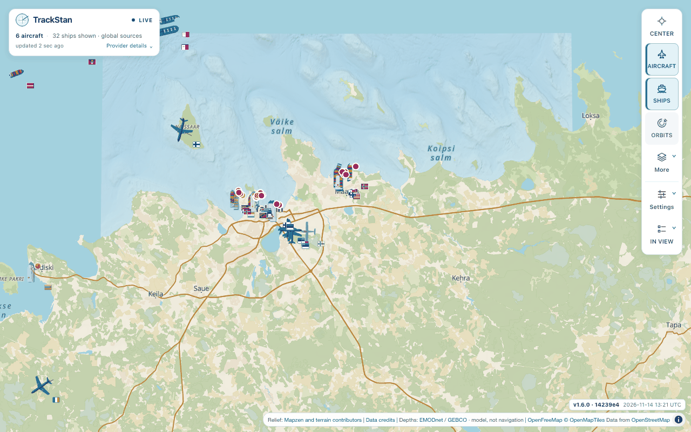
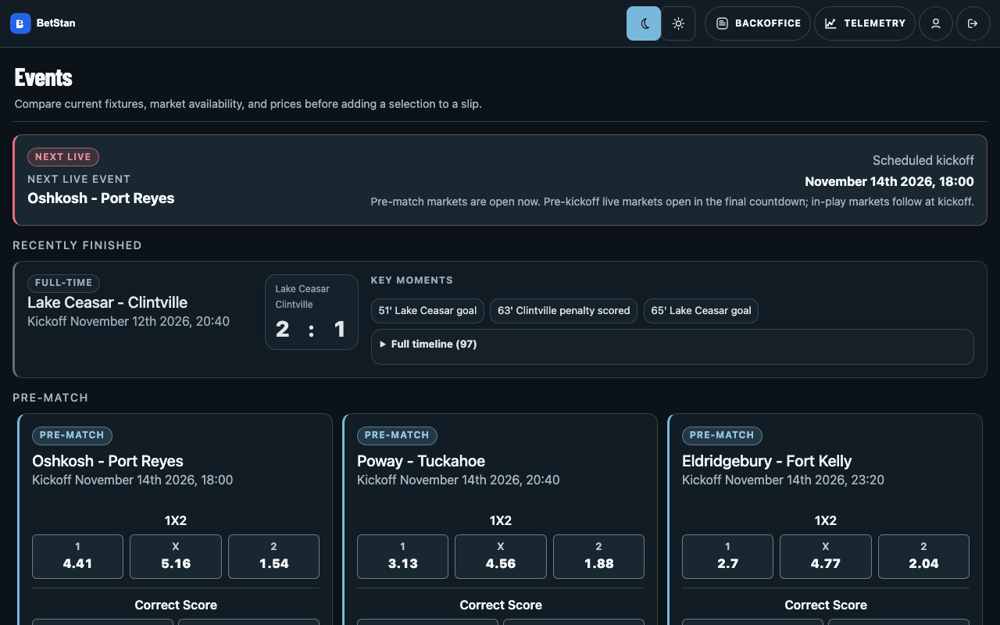
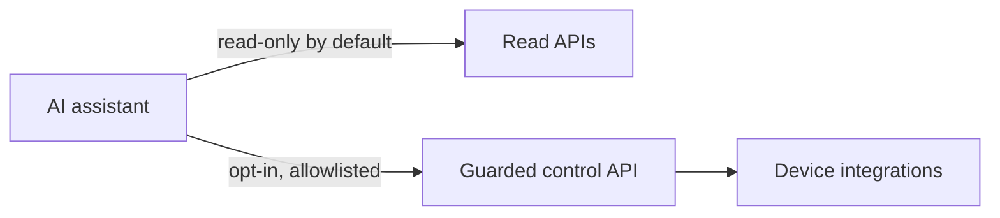
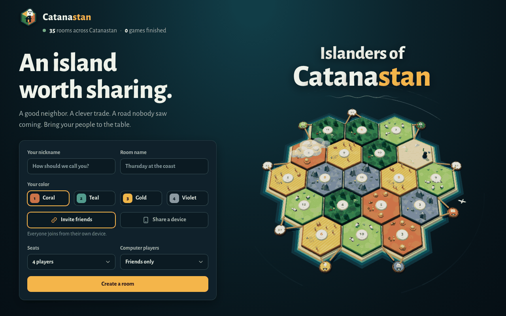
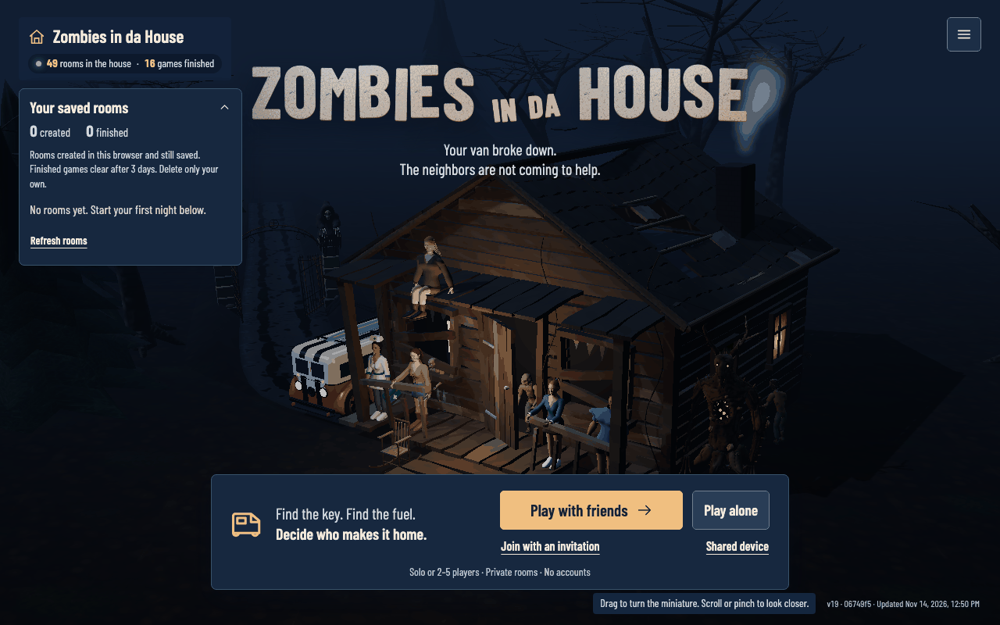

# Stan Vasilyev

**Engineering leader · platform engineering · AI-assisted development**

I'm a Principal Software Engineering Manager at Microsoft, leading a globally
distributed platform-engineering team. My 25+ years span software, product and
people leadership, including teams across three countries and engineering leadership
during a company's growth from 20 to 200+ people. I co-founded Agile Estonia.

I also build personal projects with AI coding tools. I remain responsible for
design decisions, review and verification.

_Personal projects; opinions are my own._ · [LinkedIn](https://www.linkedin.com/in/stanvasilyev/)

## Featured work

### [TrackStan](https://github.com/vasilyevstan/LiveTrafficStan)

Live air and marine traffic on an interactive map. Satellite positions are modeled, not live telemetry.

The project combines third-party data, an interactive map, partial-outage
handling and traceable production releases.

[Live demo](https://trackstan.xyz) · [Repository](https://github.com/vasilyevstan/LiveTrafficStan) ·
Evidence: [failure isolation](https://github.com/vasilyevstan/LiveTrafficStan/blob/14239e47f1a0a9b6b0cc2cbeb3f8633c1451a0f4/docs/architecture.md#L1106-L1141),
[map lifecycle](https://github.com/vasilyevstan/LiveTrafficStan/blob/14239e47f1a0a9b6b0cc2cbeb3f8633c1451a0f4/README.md#L821-L849),
[delivery workflow](https://github.com/vasilyevstan/LiveTrafficStan/blob/14239e47f1a0a9b6b0cc2cbeb3f8633c1451a0f4/.github/workflows/deploy-production.yml).

### [BetStan](https://github.com/vasilyevstan/betstan)

An event-driven sports-betting **simulation**: no real money and no real match feeds.

It combines a React client and TypeScript services. It handles duplicate
messages and recovers after service restarts, while keeping visual layouts separate
from the rules that decide bets.

[Live demo](https://betstan.xyz) · [Repository](https://github.com/vasilyevstan/betstan) ·
[AI-assisted engineering case study](articles/ai-assisted-engineering-betstan.md)

### Home Automation

A private household energy platform. AI assistants have read-only access by
default; device writes go through a separate, opt-in guarded API.

Deterministic controllers start in Shadow mode and do not write to devices.
Rollouts are explicit, and savings are reported only when they can be attributed.

Private repository; **no public demo**. [Public summary and diagrams](https://gist.github.com/vasilyevstan/1909d4b1ca8c073954b8f436e2f1d57b)

### Board games: Catanastan and Zombies in da House

| Catanastan                                                                                        | Zombies in da House                                                                                                         |
| ------------------------------------------------------------------------------------------------- | --------------------------------------------------------------------------------------------------------------------------- |
|  |  |

Two multiplayer browser games hosted on Cloudflare Workers and Durable Objects.
The server controls game state, and the same rules run locally and online. Both
support reconnects, retries and accessible 3D interaction.

- **Catanastan:** [Live demo](https://catanastan.syntal.workers.dev) · [Public summary](https://gist.github.com/vasilyevstan/658d4cf81b92f5478c3d900e2954fefd). Independent game, not an official CATAN product.
- **Zombies in da House:** [Live demo](https://zombie-in-da-house.syntal.workers.dev) · [Public summary](https://gist.github.com/vasilyevstan/a3061770fe84c1e7a48b7fa2847537f5).

Both source repositories remain private; screenshots show their public landing pages.

## Writing

[AI-assisted engineering in BetStan: a compatibility case study](articles/ai-assisted-engineering-betstan.md)

A market-layout editor looked like a visual change, but older service versions
could still write the same records. The design had to preserve compatibility.
The case study covers the fix, regression tests and the tradeoff we accepted.

## How I ship

- **One owner per change.** AI tools can help, but one person remains accountable
  for scope, review and acceptance.
- **Independent review for changes to permissions or shared data.**
- **Tie CI to the exact commit.** Passing checks do not prove deployment; releases
  also need rollback evidence.
- **Cost-aware CI.** A private platform provisions short-lived Azure VMs for jobs,
  with concurrency, lifetime and spend limits and a kill switch. It adds capacity
  when hosted minutes are constrained, but requires us to operate it. Hosted runners
  are simpler when they meet the need.

Azure VMs run CI jobs; Cloudflare Workers host the board-game demos.
