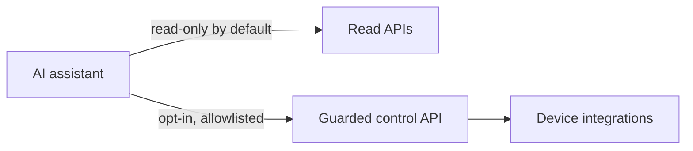

# Stan Vasilyev

**Engineering leader · platform engineering · AI-assisted development**

I lead engineering teams, with experience across product delivery, cloud platforms
and reliability. I enjoy helping engineers and leaders develop, and supporting
teams through growth and change. Clarity, trust and continuous learning guide my
approach. I've also taught at university and helped establish Agile Estonia.

I stay hands-on. These personal projects show how I use AI-assisted engineering
with clear ownership, explicit tradeoffs and evidence that a change works.

_Personal projects; opinions are my own._ · [LinkedIn](https://www.linkedin.com/in/stanvasilyev/)

## Featured work

### [TrackStan](https://github.com/vasilyevstan/LiveTrafficStan)

Live air and marine traffic on an interactive map. Satellite positions are modeled, not live telemetry.

The project combines third-party data, an interactive map, partial-outage
handling and traceable production releases.

[Live demo](https://trackstan.xyz) · [Repository](https://github.com/vasilyevstan/LiveTrafficStan) ·
Evidence: [failure isolation](https://github.com/vasilyevstan/LiveTrafficStan/blob/14239e47f1a0a9b6b0cc2cbeb3f8633c1451a0f4/docs/architecture.md#L1106-L1141),
[map lifecycle](https://github.com/vasilyevstan/LiveTrafficStan/blob/14239e47f1a0a9b6b0cc2cbeb3f8633c1451a0f4/README.md#L821-L849),
[delivery workflow](https://github.com/vasilyevstan/LiveTrafficStan/blob/14239e47f1a0a9b6b0cc2cbeb3f8633c1451a0f4/.github/workflows/deploy-production.yml).

### [BetStan](https://github.com/vasilyevstan/betstan)

An event-driven sports-betting **simulation**: no real money and no real match feeds.

I started BetStan in 2023 to learn TypeScript and build microservices. Within two
months, a working version was running on DigitalOcean. Then I put it on the shelf.

In 2026 I brought it back as a place to practise AI-assisted engineering and
multi-agent development. The productivity gain has been enormous in my own work,
but useful results depend on clear tasks, good context and careful verification.

[Live demo](https://betstan.xyz) · [Repository](https://github.com/vasilyevstan/betstan) ·
[AI-assisted engineering case study](articles/ai-assisted-engineering-betstan.md)

### Home Automation

A private household energy platform. AI assistants have read-only access by
default; device writes go through a separate, opt-in guarded API.

Deterministic controllers start in Shadow mode and do not write to devices.
Rollouts are explicit, and savings are reported only when they can be attributed.

Private repository; **no public demo**. [Public summary and diagrams](https://gist.github.com/vasilyevstan/1909d4b1ca8c073954b8f436e2f1d57b)

**Related open-source project:** [Solar MCP](https://github.com/vasilyevstan/solar)
connects AI assistants to a Huawei solar inverter over local Modbus TCP. It reads
generation and device status by default. Generation-limit controls stay off unless
enabled locally, and each change is checked by reading the value back.

### Board games: Catanastan and Zombies in da House

| Catanastan                                                                                        | Zombies in da House                                                                                                         |
| ------------------------------------------------------------------------------------------------- | --------------------------------------------------------------------------------------------------------------------------- |
|  |  |

Two multiplayer browser games hosted on Cloudflare Workers and Durable Objects.
The server controls game state, and the same rules run locally and online. Both
support reconnects, retries and accessible 3D interaction.

- **Catanastan:** [Live demo](https://catanastan.syntal.workers.dev) · [Public summary](https://gist.github.com/vasilyevstan/658d4cf81b92f5478c3d900e2954fefd).
- **Zombies in da House:** [Live demo](https://zombie-in-da-house.syntal.workers.dev) · [Public summary](https://gist.github.com/vasilyevstan/a3061770fe84c1e7a48b7fa2847537f5).

Zombies in da House's recorded code milestones run from the first playable
implementation on 6 November to v19 on 14 November 2026.
[See the prototype-to-game comparison](projects/zombies-in-da-house-edge-multiplayer.md#how-it-evolved).

Both source repositories remain private. Images show Catanastan's public landing
page and an author-supplied Zombies in da House gameplay capture.

## Writing

[What I learned building with AI coding agents](articles/ai-assisted-engineering-in-practice.md)

Across BetStan, StanStock, TrackStan, home automation and board games: faster
experimentation, difficult boundaries, and the point where too many agents and
instructions started getting in the way.

[BetStan: from learning TypeScript to AI-assisted engineering](articles/ai-assisted-engineering-betstan.md)

From a learning project in 2023 to an AI experimentation platform in 2026.
The story includes a compatibility problem, the review that caught it, and what
it taught me about using agents effectively.

## How I ship

- **One owner per change.** AI tools can help, but one person remains accountable
  for scope, review and acceptance.
- **Independent review for changes to permissions or shared data.**
- **Tie CI to the exact commit.** Passing checks do not prove deployment; releases
  also need rollback evidence.
- **Cost-aware CI.** A private platform provisions short-lived Azure VMs for jobs,
  with concurrency, lifetime and spend limits and a kill switch. It adds capacity
  when hosted minutes are constrained, but requires us to operate it. Hosted runners
  are simpler when they meet the need.

Azure VMs run CI jobs; Cloudflare Workers host the board-game demos.
