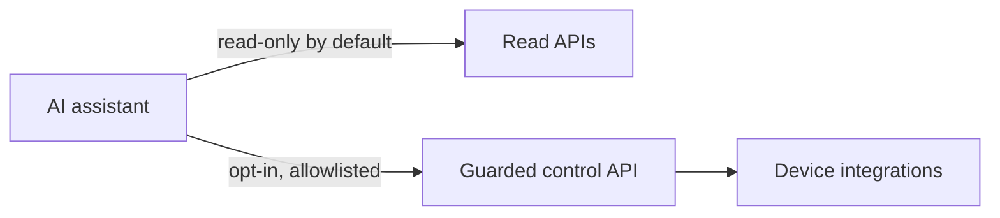

# Stan Vasilyev

**Engineering leader · platform engineering · AI-assisted software delivery**

I build teams and systems that can handle complexity without losing clarity.
My 25+ years span software, product and people leadership: distributed teams across
three countries, engineering leadership during a company's growth from 20 to 200+
people, and now a globally distributed platform-engineering team as a Principal
Software Engineering Manager at Microsoft. Co-founder of Agile Estonia.

I stay hands-on. These personal projects show how I use AI-assisted engineering
with clear ownership, explicit tradeoffs and evidence that a change works.

_Personal projects; opinions are my own._ · [LinkedIn](https://www.linkedin.com/in/stanvasilyev/)

## Featured work

### [TrackStan](https://github.com/vasilyevstan/LiveTrafficStan)

Live air and marine traffic on an interactive map. Satellite positions are modeled, not live telemetry.

**What this demonstrates:** resilient third-party integration, truthful handling
of partial outages, a stateful geospatial UI, and traceable production delivery.

[Live demo](https://trackstan.xyz) · [Repository](https://github.com/vasilyevstan/LiveTrafficStan) ·
Evidence: [failure isolation](https://github.com/vasilyevstan/LiveTrafficStan/blob/14239e47f1a0a9b6b0cc2cbeb3f8633c1451a0f4/docs/architecture.md#L1106-L1141),
[map lifecycle](https://github.com/vasilyevstan/LiveTrafficStan/blob/14239e47f1a0a9b6b0cc2cbeb3f8633c1451a0f4/README.md#L821-L849),
[delivery workflow](https://github.com/vasilyevstan/LiveTrafficStan/blob/14239e47f1a0a9b6b0cc2cbeb3f8633c1451a0f4/.github/workflows/deploy-production.yml).

### [BetStan](https://github.com/vasilyevstan/betstan)

An event-driven sports-betting **simulation**: no real money and no real match feeds.

**What this demonstrates:** end-to-end product engineering across React and
TypeScript services, reliability under duplicate messages and restart recovery,
and compatibility-first changes that keep presentation separate from betting authority.

[Live demo](https://betstan.xyz) · [Repository](https://github.com/vasilyevstan/betstan) ·
[AI-assisted engineering case study](articles/ai-assisted-engineering-betstan.md)

### Home Automation

A private household energy platform where AI assistants have read-only access by
default and device writes pass through a separate, opt-in guarded API.

**What this demonstrates:** safe autonomy for software acting on physical equipment,
deterministic controllers that start in zero-write Shadow mode, explicit rollout
decisions, and measurement that withholds unattributable savings.

Private repository; **no public demo**. [Public summary and diagrams](https://gist.github.com/vasilyevstan/1909d4b1ca8c073954b8f436e2f1d57b)

### Board games: Catanastan and Zombies in da House

| Catanastan                                                                                        | Zombies in da House                                                                                                         |
| ------------------------------------------------------------------------------------------------- | --------------------------------------------------------------------------------------------------------------------------- |
|  |  |

Two multiplayer browser games with server-authoritative game state, local
development runtimes, and online deployments on Cloudflare Workers and Durable Objects.

**What this demonstrates:** shared rules across runtimes, reconnect and retry
handling, accessible 3D interaction, and hands-on product iteration.

- **Catanastan:** [Live demo](https://catanastan.syntal.workers.dev) · [Public summary](https://gist.github.com/vasilyevstan/658d4cf81b92f5478c3d900e2954fefd). Independent game, not an official CATAN product.
- **Zombies in da House:** [Live demo](https://zombie-in-da-house.syntal.workers.dev) · [Public summary](https://gist.github.com/vasilyevstan/a3061770fe84c1e7a48b7fa2847537f5).

Both source repositories remain private. Screenshots show public landing pages,
not private game rooms or authenticated sessions.

## Writing

[AI-assisted engineering without outsourcing judgment: a BetStan case study](articles/ai-assisted-engineering-betstan.md)

A visual editor looked like a presentation-only change. Mixed-version writers made
it a compatibility problem. The case study follows the review, design correction,
regression evidence and tradeoff we accepted.

## How I ship

- **One accountable owner per change.** AI agents and specialists help; one owner
  remains responsible for scope, verification and acceptance.
- **Independent review where trust or state boundaries change.** Ordinary changes
  get proportionate checks rather than an unnecessary chain of handoffs.
- **Traceable release gates.** Exact-commit CI and rollback evidence distinguish
  source acceptance from deployment.
- **Cost-aware CI infrastructure.** A private runner platform provisions ephemeral,
  per-job Azure VMs with concurrency and lifetime limits, spend guardrails and a
  kill switch. It provides bounded capacity when hosted minutes are constrained;
  hosted runners remain the simpler choice when they meet the need. Self-managed
  capacity trades operational work for control and isolation.

Azure VMs provide CI compute; Cloudflare Workers host the board-game demos.
Private source, household data and infrastructure identifiers are not published here.
