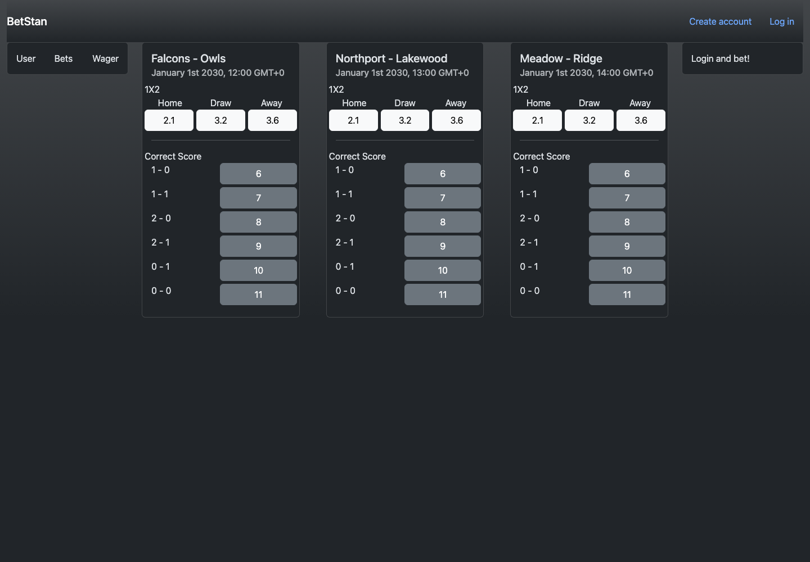
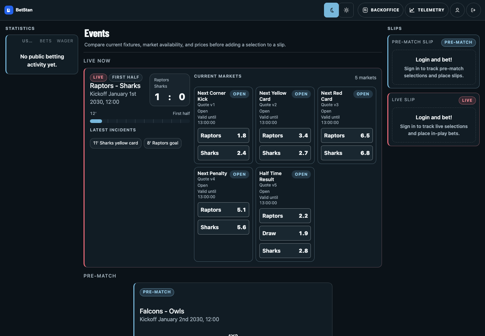
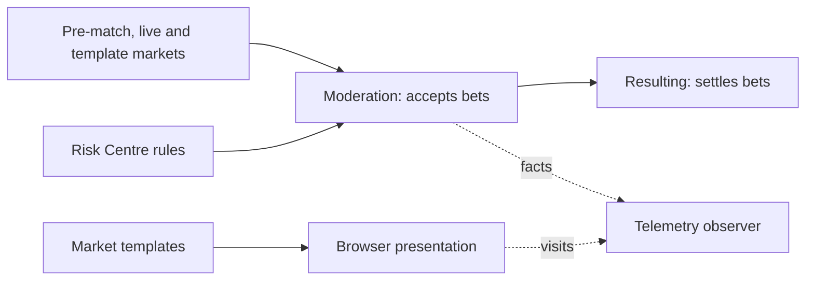

# BetStan: from learning TypeScript to AI-assisted engineering

_Stan Vasilyev · personal project; opinions are my own._

[BetStan](https://github.com/vasilyevstan/betstan) is a sportsbook **simulation** I
build hands-on with AI coding agents. It has
[no real-money bets or real match feeds](https://github.com/vasilyevstan/betstan/blob/eeb60e6ebec34945b16de734c3361d00fcbc300b/README.md#L3-L7).

My companion article, [What I learned building with AI coding agents](ai-assisted-engineering-in-practice.md),
is about the delivery process breaking and how I cut it back. This one is the other
side: what an architecture I understand, plus a process that works, let me add to
the product.

## Where it started

I started BetStan in 2023 to learn TypeScript and build microservices. Within about
two months I had a working version running on DigitalOcean. Then I put it on the
shelf.

The earliest history I can still show is from 2024. A
[preserved snapshot from that time](https://github.com/vasilyevstan/betstan/tree/ce1a5a6323b85d7cb5b101e3c903d140ed5c5e31)
already had the basics:

- [sign-up, login and logout](https://github.com/vasilyevstan/betstan/blob/ce1a5a6323b85d7cb5b101e3c903d140ed5c5e31/client/src/App.js#L50-L70),
  an event catalogue, bet slips, and betting history and statistics;
- pre-match [match-winner (1X2) and correct-score markets](https://github.com/vasilyevstan/betstan/blob/ce1a5a6323b85d7cb5b101e3c903d140ed5c5e31/client/src/pages/event/product/ProductsList.js#L5-L17);
- a Backoffice to create events, control visibility and enter results;
- services to accept and settle bets, plus a
  [Gamemaster](https://github.com/vasilyevstan/betstan/blob/ce1a5a6323b85d7cb5b101e3c903d140ed5c5e31/gamemaster/src/worker/GamemasterWorker.ts#L17-L78)
  that drew random final scores and created replacement events. Matches did not
  progress live.

That is an early preserved baseline, not an exact inventory of the 2023 version.
The project also has a 2025 history on Azure before the work described below.

| Early preserved baseline (2024 source) | Later interface (2026 source) |
| --- | --- |
|  |  |

_Both images were rendered from source at
[`ce1a5a6`](https://github.com/vasilyevstan/betstan/tree/ce1a5a6323b85d7cb5b101e3c903d140ed5c5e31) and
[`1f6728a`](https://github.com/vasilyevstan/betstan/tree/1f6728ac71430b3f0a1da457045d3a7f273b25ca)
with synthetic data and no external requests. They are not screenshots from the
time and do not show that a deployed backend works. The early build used a current
compatible toolchain._

## A second life with AI agents

In 2026 I returned to BetStan as a place to practise AI-assisted and multi-agent
engineering. Instead of starting another prototype, I could extend a system
whose data flow and responsibilities I already understood.

BetStan's services exchange durable facts over a message bus. Delivery is
[at-least-once](https://github.com/vasilyevstan/betstan/blob/eeb60e6ebec34945b16de734c3361d00fcbc300b/docs/wiki/Architecture.md#L159-L170):
duplicates and reordering are expected, consumers must be safe to replay, and the
live stream to browsers is a projection rather than the source of truth. Moderation
decides whether a bet is accepted; Resulting decides how it settles.

Those boundaries gave the features below a place to fit without rebuilding
the product around each one. Agents helped with implementation; I still had to
decide where each new piece belonged. This is a simplified view of the
responsibilities, not a deployment diagram:

A note on timing: the durations below are elapsed time between public commits and
pull requests. They are not person-hours or a controlled productivity
measurement, and merging source is not the same as switching a feature on in
production. I say which is which.

## Live betting: live in about ten days

Live betting added ten-minute simulated matches with incidents, five live markets,
separate pre-match and live slips, quotes moderated by the authoritative service,
and durable settlement and history. Matches survive a restart, and existing events
keep their legacy defaults.

The first feature contract and a deterministic match simulation were committed the
same evening. About a day later the end-to-end source
[merged](https://github.com/vasilyevstan/betstan/pull/219), with live kickoff still
switched off. Successful permanent activation in production was recorded roughly
ten days after that first commit. The
[activation record](https://github.com/vasilyevstan/betstan/pull/430) and the
[pinned lessons](https://github.com/vasilyevstan/betstan/blob/1f6728ac71430b3f0a1da457045d3a7f273b25ca/infra/oci/LESSONS_LEARNED.md#L757-L792)
cover browser, settlement, restart and live-stream checks. The next day a
[follow-up](https://github.com/vasilyevstan/betstan/pull/432) fixed card density,
grouping of finished matches, history readability and pre-match pricing.

It was not easy. Restarts, quote handling and settlement each needed evidence
before I switched anything on. But a complete new way of betting went from idea
to production in under two weeks. From my experience leading engineering teams,
I would have planned several months for a small team of senior engineers to
reach the same point.

**Learning:** the agents wrote the first version in a day; the remaining days
went into proving it. Keeping live kickoff off until then let me move fast
without gambling with the running product.

## Market templates: a new product capability in under three days

Market templates let an operator define a reusable, versioned market once and use
it across events. Each event keeps its own snapshot. Templates describe which
scores win and use modelled or manual prices; they flow through the existing
quoting, moderation, settlement and history paths. A visual designer arranges
outcome tiles on a grid: columns, spans, spacing and shapes, with pointer and
keyboard controls. That lets me reuse a market with different presentations
instead of building a separate screen each time. The flexibility is deliberately
bounded: the designer does not accept arbitrary HTML or CSS.

From the first reusable-market contracts to the
[template source](https://github.com/vasilyevstan/betstan/pull/1039) took about
half a day. The [visual designer](https://github.com/vasilyevstan/betstan/pull/1057)
and copyable starter templates were
[released](https://github.com/vasilyevstan/betstan/pull/1059) and successfully
deployed to production less than three days after those first contracts.

An independent review caught a compatibility problem: adding layout fields to
records that older services copied or compared was not harmless metadata.
Layouts now live
[beside the betting configuration, not inside it](https://github.com/vasilyevstan/betstan/blob/1f6728ac71430b3f0a1da457045d3a7f273b25ca/docs/wiki/Architecture.md#L212-L255),
and tests replay the old record shape. An older writer may lose optional
presentation during an edit, but the betting configuration stays unchanged.
The issue was caught before production.

**Learning:** you can change how markets look without touching the rules that
price and settle them, as long as presentation stays out of the authoritative data.
That separation is what made days, rather than weeks, realistic.

## Risk Centre: risk controls in production in about a day

Risk Centre adds rules for availability, timing and delay, stake, price, slip
structure, activity, open exposure and customer loss. Decisions record which
policy applied; reservations and saved outcomes prevent retries from consuming
capacity twice or receiving a different answer.

It was built without a new service. The rules run as a module inside the existing
Moderation service. Backoffice provides the editor, Resulting still owns money
movement, existing Slip and Bet readers supply the facts, and shared contracts are
versioned. The [core](https://github.com/vasilyevstan/betstan/pull/1068) merged
roughly two and a half hours after the first accounting-foundation commit. The
editable rules [were enabled](https://github.com/vasilyevstan/betstan/pull/1076)
and successfully deployed to production about a day after that first commit.

The [scope](https://github.com/vasilyevstan/betstan/blob/1f6728ac71430b3f0a1da457045d3a7f273b25ca/docs/wiki/Risk-Centre.md#L3-L59)
is the simulation's bet-acceptance and exposure controls, not a complete regulated
risk platform. History-based rules also need their own
[readiness checks](https://github.com/vasilyevstan/betstan/blob/1f6728ac71430b3f0a1da457045d3a7f273b25ca/docs/wiki/Risk-Centre.md#L87-L138).

**Learning:** risk management did not become easy. It became tractable, because
there was already one clear place where bets are accepted and one where they are
settled. Knowing the architecture well is what turned a hard feature into a
one-day change.

### What those three features add up to

Live betting, market templates and Risk Centre reached production in about two
weeks of elapsed time combined. From my experience leading engineering teams, I
would estimate that a small team of senior engineers would have needed roughly
six months to deliver the same three features to this level. That is a judgement,
not a measurement: I built on an architecture I knew intimately, and no team
built the same thing in parallel. Even with those caveats, the difference is
large enough to change what one person can realistically attempt.

## Telemetry: a nice-to-have that stays out of the way

I also wanted a small internal view of page visits and product activity.
The telemetry service shows route visits and observes sign-ups,
logins, slips, submissions, settlements and live updates. It draws 14-day charts
and a coarse reachability check.

It reads facts already on the message bus and keeps its own store: it observes
betting rather than deciding whether a bet is valid.
Its [semantics](https://github.com/vasilyevstan/betstan/blob/1f6728ac71430b3f0a1da457045d3a7f273b25ca/docs/wiki/Application-Processes.md#L731-L801)
are honest: a visit is a page entry, not a unique person or a conversion. The
application [merged](https://github.com/vasilyevstan/betstan/pull/560) about two
days after its first implementation commit, building on earlier groundwork. The
[readiness review](https://github.com/vasilyevstan/betstan/pull/627) that followed
did not yet treat it as live.

**Learning:** existing product events made an optional dashboard possible without
changing who accepts or settles bets. Best-effort page counters must not become
a second source of truth.

## What transfers

- **Speed is real, and it comes from architecture.** Agents turned months of
  work into days because new features attached to boundaries I understood,
  instead of creating new authority.
- **Separate source from release.** "Merged" and "live" are different claims, and
  stating which one you mean keeps the story honest.
- **Bound the flexibility.** Validated grids, versioned rules and disabled-by-default
  controls gave useful freedom without putting bet validity at risk.

**Agents help explore and implement. Accountable people and executable evidence
decide what is accepted.**
