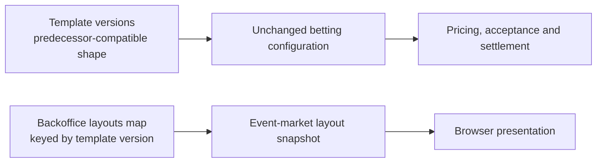

# AI-assisted engineering in BetStan: a compatibility case study

_Stan Vasilyev · personal project; opinions are my own._

[BetStan](https://github.com/vasilyevstan/betstan) is a sportsbook **simulation** I
build hands-on with AI coding agents. It has scheduled football events, compressed
live matches, pre-match and live betting, moderation and settlement, but
[no real-money bets or real match feeds](https://github.com/vasilyevstan/betstan/blob/eeb60e6ebec34945b16de734c3361d00fcbc300b/README.md#L3-L7).

This is the story of one small feature and the design decision inside it that
mattered. The interesting question is not how quickly an agent can generate a
visual editor. It is how to keep that apparently cosmetic change from altering
the contracts on which the rest of the system depends.

## The invariant: presentation never decides bet validity

BetStan's services exchange durable facts over a message bus. Delivery is
[at-least-once](https://github.com/vasilyevstan/betstan/blob/eeb60e6ebec34945b16de734c3361d00fcbc300b/docs/wiki/Architecture.md#L159-L170):
duplicates and reordering are expected, consumers must be safe to replay, and the
live stream to browsers is a projection rather than the source of truth.

A presentation feature therefore has a firm boundary. Layout can change how
outcomes appear, but it must not change the configuration used for pricing,
acceptance, moderation or settlement. This is a deliberately broad engineering
laboratory, not evidence that every product needs this service architecture or
its operational overhead.

## The brief: a visual market-layout editor

Operators needed to arrange outcome tiles: which tiles go where, how wide they
are, and how the same layout can be reused. The feature also needed to preserve
existing standard markets and avoid rewriting shared contracts merely to
change a screen.

The first impression is "just add some layout metadata." The compatibility
question is what happens when older code reads, copies, compares or rewrites the
record containing that metadata.

## The risk, in plain language

Mixed-version behavior matters during upgrades and rollbacks. An older writer
does not know about a new layout field, but it still knows the old template
version shape and the fingerprint used to recognize a repeated event-market
creation request.

Nesting optional presentation inside those existing structures is not
automatically safe. A new field can change the shape that predecessor code copies
or compares, even if the author regards it as cosmetic. Shared betting
configuration must also retain its strict, layout-free shape.

[PR #1057](https://github.com/vasilyevstan/betstan/pull/1057) records that an
independent service-contract review found a mixed-writer issue in the initial
representation. The rejected representation was corrected in isolated tests;
this was **not a production incident**.

## How the delivery process caught it

Three parts of the workflow mattered.

**One accountable owner.** BetStan's
[agent guidance](https://github.com/vasilyevstan/betstan/blob/eeb60e6ebec34945b16de734c3361d00fcbc300b/docs/wiki/Agents.md)
keeps one owner responsible for scope, implementation, verification and
acceptance. Specialists are optional capabilities, not a conveyor belt.

**Independent verification at the changed boundary.** This feature touched
persisted records shared with predecessor writers. The review therefore examined
service contracts and compatibility, not only the appearance of the editor.
After the correction, a narrow verification checked the specific boundary again.

**Separate source acceptance from release.** The
[contribution rules](https://github.com/vasilyevstan/betstan/blob/eeb60e6ebec34945b16de734c3361d00fcbc300b/CONTRIBUTING.md)
distinguish accepting source, passing the relevant exact-source checks, and
deploying it. A merged PR is not proof of production availability.

The useful contribution of AI-assisted engineering here was exploration and
implementation within that process. Agreement between models was not the
acceptance criterion; executable evidence was.

## The decision and the tradeoffs

The [final design](https://github.com/vasilyevstan/betstan/blob/eeb60e6ebec34945b16de734c3361d00fcbc300b/docs/wiki/Architecture.md#L219-L237)
separates the two paths:

- **Layouts live beside authority, not inside its shared data.** Backoffice stores
  a [map keyed by template version](https://github.com/vasilyevstan/betstan/blob/eeb60e6ebec34945b16de734c3361d00fcbc300b/backoffice/src/model/MarketTemplate.ts#L5-L41)
  and copies a layout snapshot onto each event market. Stored template versions
  and creation fingerprints keep the predecessor shape. Layout is joined into
  the authoring HTTP representation, never shared configuration or betting messages.
- **A constrained grid rather than executable design.** Coordinates, spans and
  outcome keys are validated. Missing or duplicate outcomes and overlapping tiles
  are rejected. Arbitrary HTML, CSS and code are out of scope.
- **A bounded loss is acceptable.** An older writer may omit or drop optional
  presentation during an edit. Rules, prices and accepted bets remain unchanged.
  We accepted that limitation instead of assuming every writer upgrades together.
- **No shared-package migration.** Keeping presentation out of the shared
  contracts avoids a coordinated contract release for this feature.

## The evidence

Two regression tests exercise the compatibility claim:

- The [predecessor-shaped test](https://github.com/vasilyevstan/betstan/blob/eeb60e6ebec34945b16de734c3361d00fcbc300b/backoffice/src/route/__test__/Markets.test.ts#L106-L130)
  uses the old instance shape and fingerprint, replays the creation request,
  publishes, and checks that publisher arguments contain no layout.
- The [snapshot test](https://github.com/vasilyevstan/betstan/blob/eeb60e6ebec34945b16de734c3361d00fcbc300b/backoffice/src/route/__test__/Markets.test.ts#L61-L91)
  checks that editing or archiving a template does not change the event-market
  layout snapshot, and that the published configuration remains layout-free.

PR #1057 also records service tests and eight synthetic-browser journeys.
Those are **historical PR-reported results**, not tests rerun for this article.
The PR explicitly makes no production-availability claim. The sources establish
an AI-assisted workflow, but do not establish which particular model found the
defect or a measured productivity improvement.

## What transfers to other teams

The strongest outcome was a smaller contract change, not more orchestration.
Make the risky boundary explicit, keep one person accountable, and ask for
independent evidence at that boundary. Once a concrete defect is corrected,
verify that correction rather than repeating an entire review ceremony.

The same principle informs my private home-energy project: assistants are
read-only by default, device writes follow a separate guarded path, and new
controllers start in zero-write Shadow mode. Greater control requires evidence
gates or an explicit owner decision; controllers are never armed automatically.

**Agents help explore and implement. Accountable people and executable evidence
decide what is accepted.**
