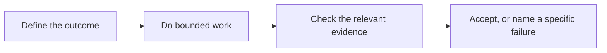
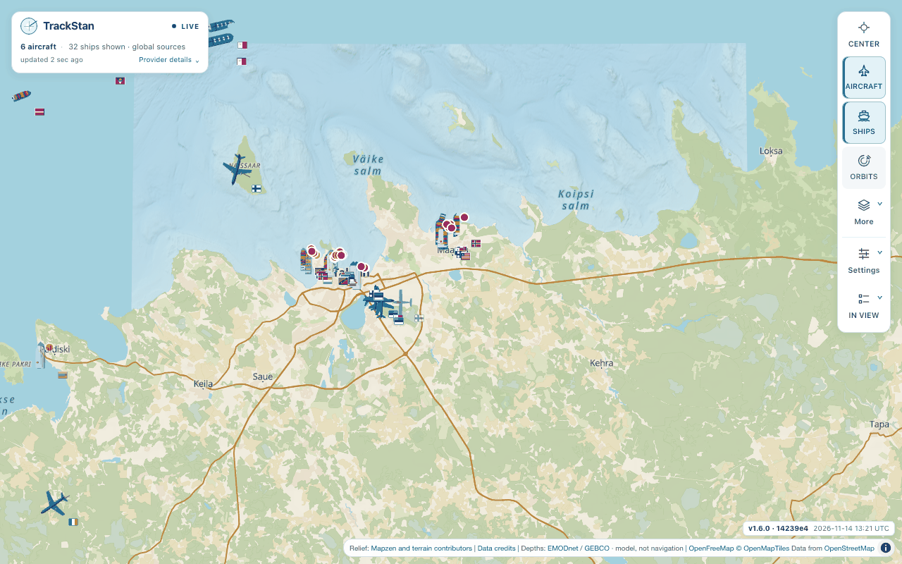
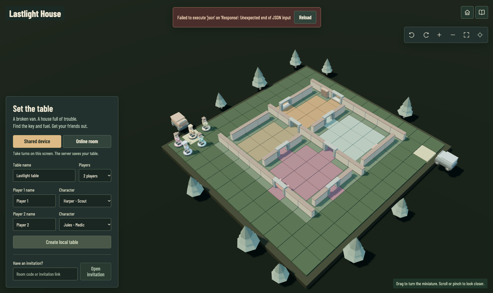
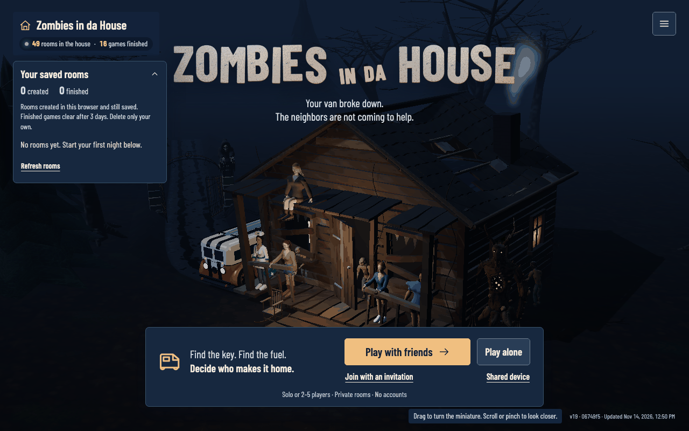

# What I learned building with AI coding agents

_Stan Vasilyev. Personal projects; opinions are my own._

Used well, AI coding agents can make engineering work dramatically more
productive—not just by helping one person write code faster, but by helping
teams explore alternatives and move independent work forward in parallel. The
gains are not automatic: too many agents, documents and checks can make finishing
a change harder than writing it.

These examples show both the leverage and the judgment needed to use it well.
They are project case studies, not a controlled productivity study. Across them,
the hard questions are what data to trust, when a change is ready, and when
software is allowed to act.

An agent is a coding assistant given a task, context and tools. Several can work
on bounded tasks in parallel, but their results still need to be reconciled and
checked by an accountable owner.

## BetStan: the learning goal changed

I started [BetStan](https://github.com/vasilyevstan/betstan) in 2023 to learn
TypeScript and build microservices. Within two months, I had a working version
running on DigitalOcean. Then I put it on the shelf. In 2026 I returned to it as
a place to practise AI-assisted and multi-agent engineering.

It remains a sports-betting **simulation**, with no real money or real match
feeds. But its engineering problems are real: messages arrive more than once,
services restart, and older software may still write the same data as newer
software. The [compatibility case study](ai-assisted-engineering-betstan.md)
examines one such change.

### Moving from Azure to OCI

One difficult episode was moving the system from Azure to Oracle Cloud
Infrastructure (OCI) to run it under tighter cost constraints. Moving containers
was only part of it: scheduled tasks and messages already in the queue could
still change data during the handoff.

One attempt to stop writes was to revoke messaging permissions. That broke the
services sending messages and caused the receiving processes to disappear,
instead of leaving a quiet system that could be safely restarted. The [revised procedure](https://github.com/vasilyevstan/betstan/pull/205)
controlled message routing instead, kept the message consumers registered, and
specified the order for restarting services and recovering from failures.

The important question was: **what evidence makes it safe to allow writes
again?** Agents could help investigate mismatches, work through plans and
prepare checks. A coherent plan or passing source review was not, by itself,
evidence that the data handoff had succeeded.

Later records report [Azure resource retirement as complete](https://github.com/vasilyevstan/betstan/pull/214),
while billing data was still pending. The [current architecture](https://github.com/vasilyevstan/betstan/blob/e3c2edc7e6dc76bd4b36d690696e25f68625bd16/docs/wiki/Infrastructure.md#L3-L13)
identifies OCI as production.

## When the process took over

At times BetStan felt less like a software project and more like an expanding
set of instructions about how software might be changed. More specialist agents,
more Markdown and more reviews did not necessarily bring a change closer to
completion.

One [simplification](https://github.com/vasilyevstan/betstan/pull/988) edited
eighteen Markdown files, centralising duplicated guidance and removing mandatory
model agreement and reviews of reviews. It changed no executable code.
[Another](https://github.com/vasilyevstan/betstan/pull/1007) consolidated thirteen
agent roles into nine, clarified one owner's responsibility and removed
duplicated test work.

A later, separate [stall](https://github.com/vasilyevstan/betstan/pull/1041)
involved an agent waiting for every pull-request status to turn green. The
required checks had passed, but one informational status was deliberately
pending. The watcher was waiting for the wrong definition of "done".

The fix was not to ignore failing checks. It was to wait for the required checks
on the correct commit, and stop on failure, source changes or timeout. Finishing
that wait still did not grant permission to merge or deploy.

The counts were not the point. I still needed tests tied to the code being
released, independent review of sensitive changes, protection against conflicting
writes and a way to recover. What I did not need was duplicated work and reviews
of reviews. I could reuse valid evidence instead of reopening the same review
without a new reason.

My smaller working pattern was:

One owner stays responsible throughout. Specialists are useful when they fill
a concrete gap, not because every task needs the whole cast.

## The same tools, different kinds of judgment

### StanStock: history is not the same as current advice

[StanStock](https://github.com/vasilyevstan/stanstock) is a local-first stock
research and simulation application, not a broker. A freshness check correctly
prevented old forecasts from appearing current. But it also hid verified
historical research that was still useful to inspect.

The [change](https://github.com/vasilyevstan/stanstock/pull/88) let selected pages
show that material explicitly as history, while keeping current shortlists
disabled and rejecting future or corrupt evidence. The PR records AI-assisted
development, separate reviews and synthetic regression cases.

The useful requirement was not "make the old results appear". It was "make
history visible without presenting it as a current recommendation". That
distinction had to survive the implementation and its tests.

### TrackStan: a plausible map can still be wrong

_TrackStan's public map. Source coverage and freshness vary; satellite positions
are modelled, not live telemetry._

[TrackStan](https://github.com/vasilyevstan/LiveTrafficStan) combines external
traffic feeds on an interactive map. One [recovery change](https://github.com/vasilyevstan/LiveTrafficStan/pull/603)
had to preserve the wait before asking a provider for data again, even when
the user moved the map or paused and resumed updates. Asking too soon would have
broken the provider's rules.

It also rejected positions dated implausibly far in the future before they
could make cached data appear fresh. Tests with a controlled clock made those
cases repeatable. Getting
markers on screen was only the visible part; deciding when their data could be
trusted was part of the feature too.

### Home Automation: a safety check can be too strict

In my private home-energy project, an AI assistant can propose a limit on solar
output. A separate controller, following fixed rules rather than model judgment,
decides whether a command is allowed. It records the intended change and checks
the device again before acting.

The first supervised attempt stopped before sending a command. The guard had
mistaken normal changes in live power output for a change to the device's
configuration. Nothing was written.

The fix was a clearer definition of what must remain stable: configuration and
limits stay guarded; live power is an observation used in the decision. A
regression test preserves that distinction. A later supervised cap-and-restore
cycle was recorded with separate read-back checks.

That is one supervised hardware trial, not evidence of long-run reliability. The
lesson was not to give the model more authority. It was to make the boundary
between a suggestion and a physical action more precise.

## Board games make the iteration visible

Zombies in da House provides a more immediate picture of the change:

| Early prototype: Lastlight House | Later landing page: Zombies in da House |
| --- | --- |
|  |  |

_Author-supplied screenshots: an early setup screen and the later game's landing
page. Capture dates and exact code revisions are unknown. The setup screen
includes an error banner._

The [recorded development milestones](../projects/zombies-in-da-house-edge-multiplayer.md#recorded-development-milestones)
run from the first browser implementation on 6 November to v19 on 14 November
2026, just over seven days. That is a code-history interval, not a measure of
hours worked or the time between these screenshots.

The evolution included character models, textured surroundings, furnished
rooms, solo companions, autopilot and clearer turn controls. The game bots
follow game rules; they are not the coding agents used to develop the product.

[Catanastan](../projects/catanastan-edge-multiplayer.md) adds a less visible
example. One rules engine supports a local server and the Cloudflare-hosted
game. The server validates actions and sends each player only their view of the
state. Reconnects and retries must not turn into extra game actions. A polished
3D board does not solve those problems by itself.

These projects let me explore product ideas and visual changes quickly, while
still confronting the work behind a usable multiplayer game.

## What I keep doing differently

- **Start with a bounded outcome.** Give an agent a clear task and the context it
  needs, not every historical instruction.
- **Use specialists for a reason.** Independent work can run in parallel;
  additional opinions should address a specific uncertainty.
- **Make "done" observable.** Name the behavior and evidence that matter, rather
  than asking another agent for general reassurance.
- **Keep one owner through delivery.** Reuse valid evidence, resolve concrete
  failures and distinguish merged code from an observed running result.

The productivity opportunity is bigger than faster coding: it is exploring more
options and moving independent work forward without losing ownership of the
result. That takes knowing what to delegate, what to verify, and when to stop
adding machinery.
