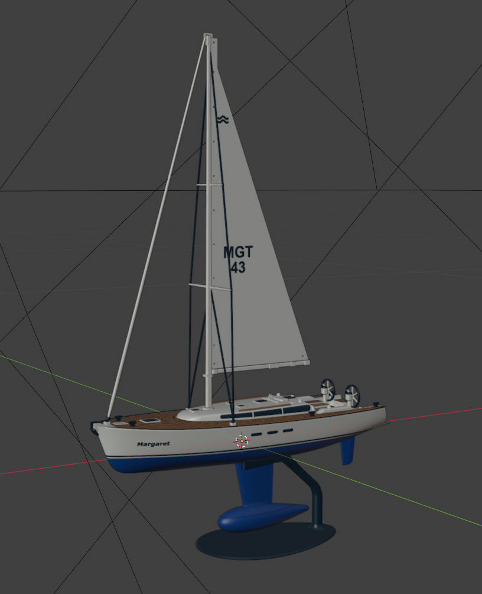
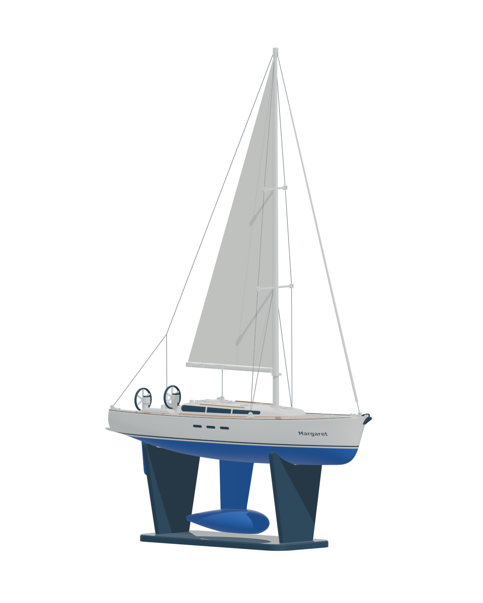
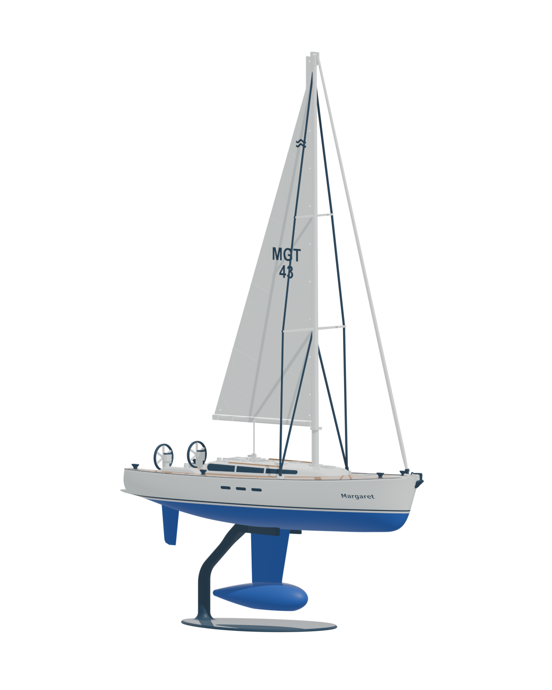
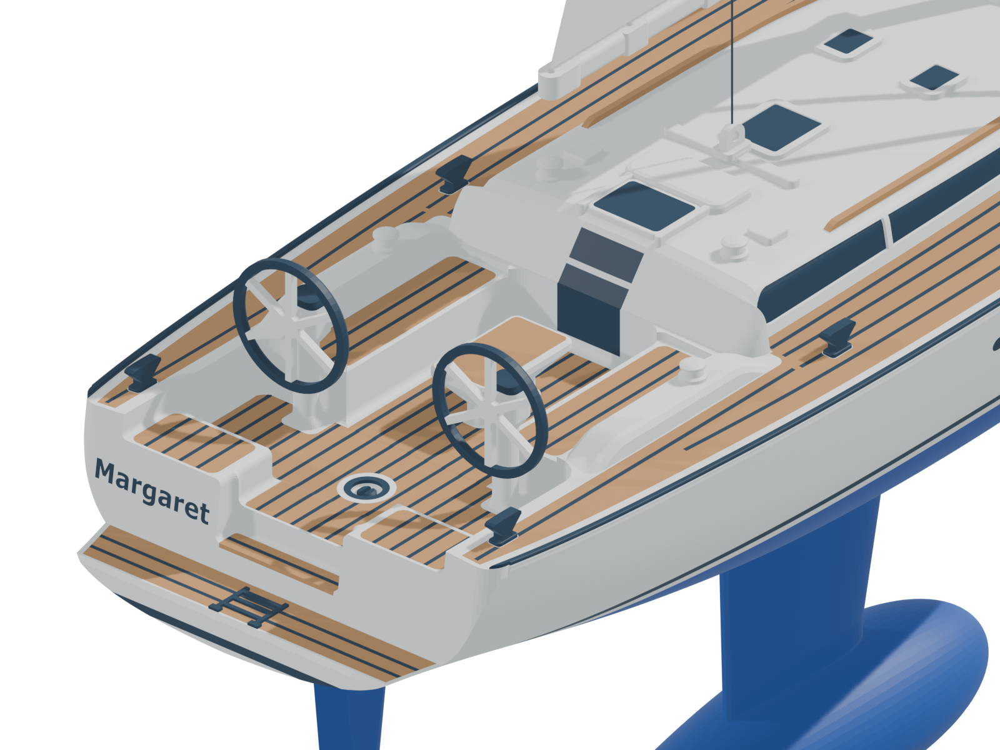

# Margaret: from an idea to a boat I can hold

Margaret started as a description of a boat I wanted to make. Now she is a 20 cm model yacht I can pick up, touch and put on the water. She floats.

That is what makes this project exciting to me: this particular model did not exist before we started. It was not a boat file I downloaded and sent to a printer. With AI tools, I went from an idea through design iterations in Blender to a physical object.

I wanted a white cruising yacht with a blue underwater hull, inspired by the Jeanneau Sun Odyssey 43 rather than an exact replica. AI helped write the [Blender scripts](https://github.com/vasilyevstan/3d-design/tree/5b4d8f5f82e57f1d7ad0cde46171988319d04691/Margaret/scripts) that generated the geometry. I could inspect the result, explain what I wanted to change, and rebuild it.

*Margaret in Blender. This is the digital model, not a photograph of the print.*

## It took iterations, not a single prompt

The first draft was recognisably a boat, but not yet the boat I wanted. The hull was too angular, the proportions were off, and the cabin and stern needed work. AI reviewers challenged the shape and whether it could be printed. We rebuilt the hull's curves rather than just making the render look smoother.

Then came the details that made her Margaret: the teak-patterned deck, twin steering wheels, hatches, an anchor, her name on the hull and **MGT 43** on the sail. The rigging became printable, and the display stand evolved from a cradle to a single curved support. Each round gave me something concrete to look at and respond to.

| Earlier published model | Later refinement |
| --- | --- |
|  |  |

*Actual repository renders from [v7f](https://github.com/vasilyevstan/3d-design/tree/7372723ee29ea13ddb350574227c45bceb32bcb3/Margaret) and [v7l](https://github.com/vasilyevstan/3d-design/tree/5b4d8f5f82e57f1d7ad0cde46171988319d04691/Margaret). These show later refinements, not the first draft.*

## From the screen to the printer

A detailed model still had to become printable parts. We worked out how to split and orient them, which details would survive at this scale, and how to use four filament colours for the white hull, blue bottom, navy trim and teak-coloured deck. Some details stayed out: scale lifelines would have been thinner than the printer could reproduce.

I used Bambu Studio to prepare the parts and a Bambu Lab P2S to print the boat. The design was no longer something I could only rotate on a screen. It had physical shape, weight and texture.

*A render of the cockpit details we developed through the iterations. The pictures on this page document the design; they are not photographs of the printed boat.*

## More than a display model

I wanted Margaret to float, not just look like a yacht on a stand. That changed the design: a deeper keel holds ballast low down, and its hollow bulb can be filled after printing. There are interchangeable paper sails for use on the water and an optional printed sail for display.

The [repository documents the weight and buoyancy calculations](https://github.com/vasilyevstan/3d-design/blob/5b4d8f5f82e57f1d7ad0cde46171988319d04691/Margaret/README.md). Those are design predictions, not measured sailing performance. The physical boat floats; how she handles different sails and wind conditions is a separate question.

For me, the lesson is that AI-assisted creation does not have to end with software or a picture. I still had to choose, inspect and refine, but AI helped turn those decisions into a model I could manufacture. Something that began as an idea is now a boat I can hold.

The project is open: [explore Margaret's Blender model, printable files and sail templates](https://github.com/vasilyevstan/3d-design/tree/main/Margaret), or follow the decisions in the [design iteration log](https://github.com/vasilyevstan/3d-design/blob/5b4d8f5f82e57f1d7ad0cde46171988319d04691/Margaret/REVIEW.md).
