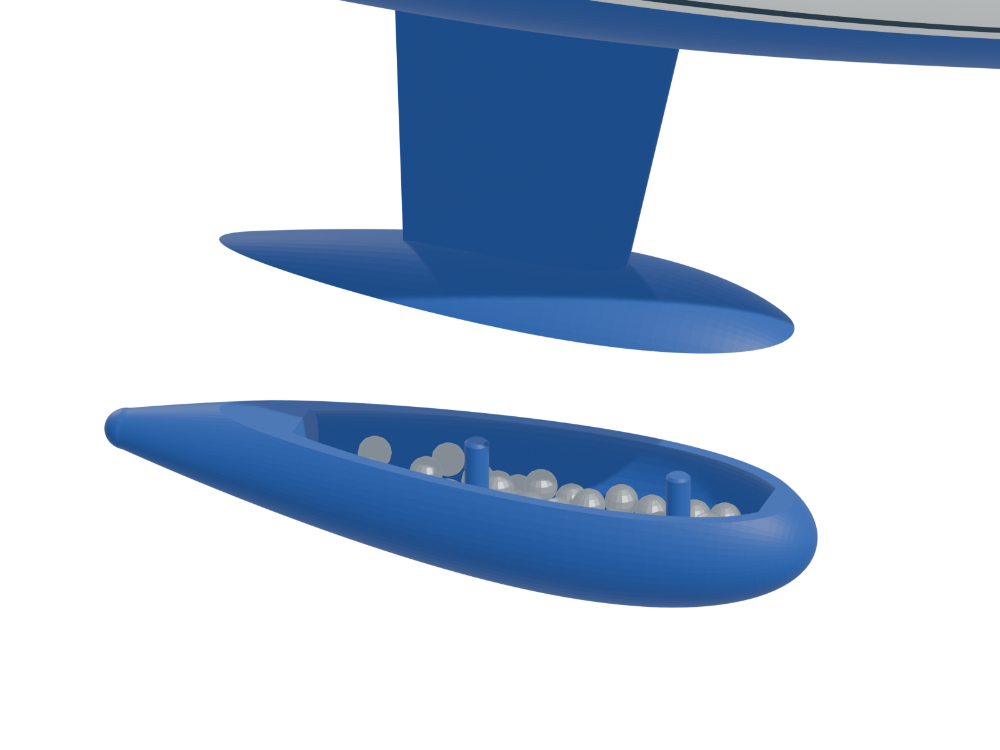

# Margaret: from a Blender script to a boat I could hold

The keel on my 3D-printed yacht, Margaret, wobbled. It hadn't wobbled in Blender. That small difference became the most useful part of a project that started with a description of a boat and ended with a 20 cm model I could hold.

I wanted Margaret to look like a Jeanneau Sun Odyssey 43: a white cruising yacht with a blue hull below the waterline. Rather than download an existing model, I used AI tools to help write and revise a [Blender script](https://github.com/vasilyevstan/3d-design/blob/f9dbe1a14abb596827c0390c4e0ced3a755b7a0b/Margaret/scripts/build_v7.py) that built her. Keeping the design in code meant I could change the shape of the hull or the size of a joint and rebuild the parts without redrawing the boat.

*The Blender model. I kept the name on the bow and the sail number, but left off the lifelines: at this scale they would be just 0.1 mm thick, too fine for my printer's 0.4 mm nozzle.*

## What a picture couldn't tell me

A scale copy would have put the ballast too close to the hull. I gave Margaret a deeper keel and a hollow bulb at its tip. The bottom of the bulb comes off, so I could print it empty, add weight and close it again. I sliced the parts in Bambu Studio and printed the boat on a Bambu Lab P2S.

*Exploded render of the ballast cup. The gap is there to show how the parts go together.*

With the print in hand, I went back to the loose keel. I asked the AI reviewers to check the joint against both the model and the paths the printer would actually follow. The fin had about 0.20 mm of clearance on each side. That sounds tiny until you remember there's a weight at the far end. The next design halved the clearance to 0.10 mm per side. Changing the socket in the lower hull let me keep the fin, rudder and upper hull I'd already printed.

*The middle column shows the change: the green fin stays the same; the blue socket gets narrower. These are design dimensions, not measurements of a second print.*

What I'd repeat on another project is that last loop. AI helped me turn an idea into geometry I could edit. Holding the print told me which edit was worth making.

[Explore the model and printable files](https://github.com/vasilyevstan/3d-design/tree/main/Margaret) · [Read the assembly-fit review](https://github.com/vasilyevstan/3d-design/blob/f9dbe1a14abb596827c0390c4e0ced3a755b7a0b/Margaret/REVIEW.md#step-14--assembly-fits-measured-on-the-toolpaths-v7k)
