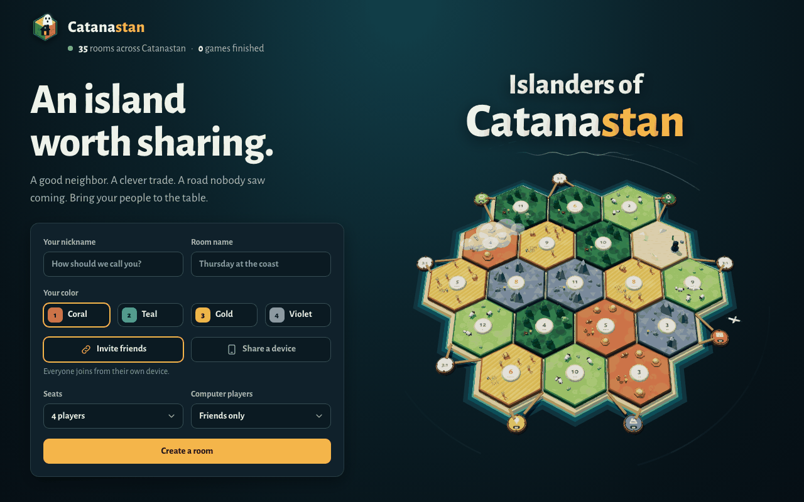
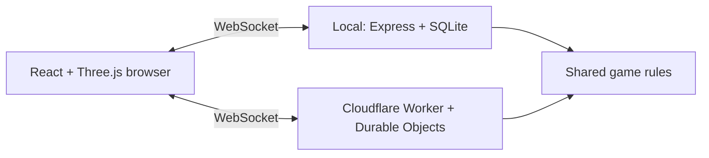

# Catanastan: server-authoritative multiplayer at the edge

An original three- or four-player island strategy game with shared rules across
local and edge runtimes.

**[Play the live demo](https://catanastan.syntal.workers.dev)** · private source repository

Gather resources, trade, build roads and settlements, and reach ten points.
Play with friends on their own devices, pass a device around the table, add
lightweight computer opponents, or mix all three. No accounts are needed.

## What this demonstrates

- **Server-authoritative multiplayer:** WebSocket clients send actions; the server
  validates them and shares player-specific state.
- **Shared rules across runtimes:** one game engine powers Express with SQLite
  locally and Cloudflare Workers with Durable Objects online.
- **3D browser experience:** React and TypeScript pair with a Three.js island and
  keyboard-accessible game controls.
- **AI-assisted product delivery:** hands-on development with coding agents,
  explicit release checks, and an edge-hosted playable product.

The test suite covers duplicate and stale commands, restart-after-save retries,
private per-player projections and room isolation. Browser journeys exercise
trades, human-plus-bot tables and shared-device play. These describe the project's
test coverage, not a claim about production scale or uptime.

_Personal project; opinions are my own. More: [github.com/vasilyevstan](https://github.com/vasilyevstan)_
