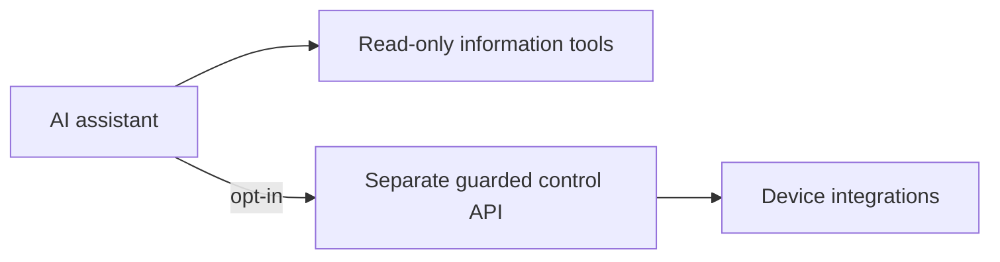
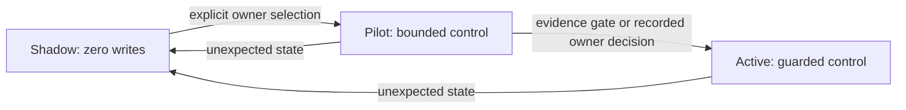
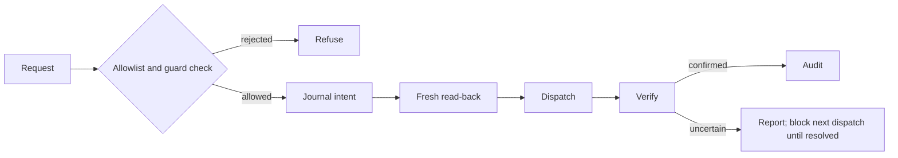

# Home Automation: guarded AI agents for a household energy platform

A private Home Assistant-based platform: read-only access by default, a separate
guarded path for device writes, and deterministic control rather than LLM decisions.

**Private system - no public demo. Architecture walkthrough available on request.**

Built hands-on with AI coding agents, the system connects read-only information
tools with separately enabled control interfaces. Writes are opt-in and
allowlisted, journal intent, re-read current state, and report uncertainty instead
of blindly replaying commands. Private source and household data remain private.

## What this demonstrates

- **Safe autonomy for AI agents acting on physical equipment.** Assistants are
  read-only by default. Device writes go only through a separate, opt-in,
  allowlisted control API that journals intent, re-reads state before dispatch,
  and reports uncertainty instead of replaying commands.
- **Evidence-gated rollout.** Deterministic, non-LLM controllers start in zero-write
  Shadow mode, are never armed automatically, and reach fuller control through
  explicit evidence gates or a recorded owner decision. Installed, loaded and
  active are verified as separate release states.
- **Honest measurement and learning.** Missing data is not treated as zero,
  savings stay unreported until energy can be attributed, and incidents get
  blameless postmortems that widen acceptance checks.

## Access boundaries

## Deliberate rollout

## Guarded writes

These are intentionally abstract diagrams, not operational configuration.
No credentials, household readings, device identifiers or private endpoints are published.

_Personal project; opinions are my own. More: [github.com/vasilyevstan](https://github.com/vasilyevstan)_
