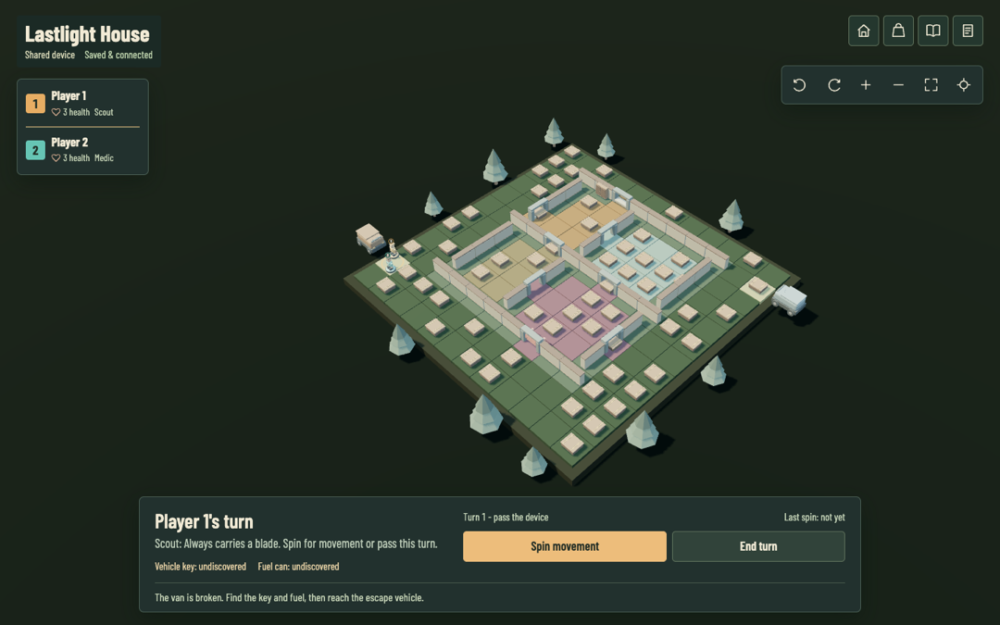
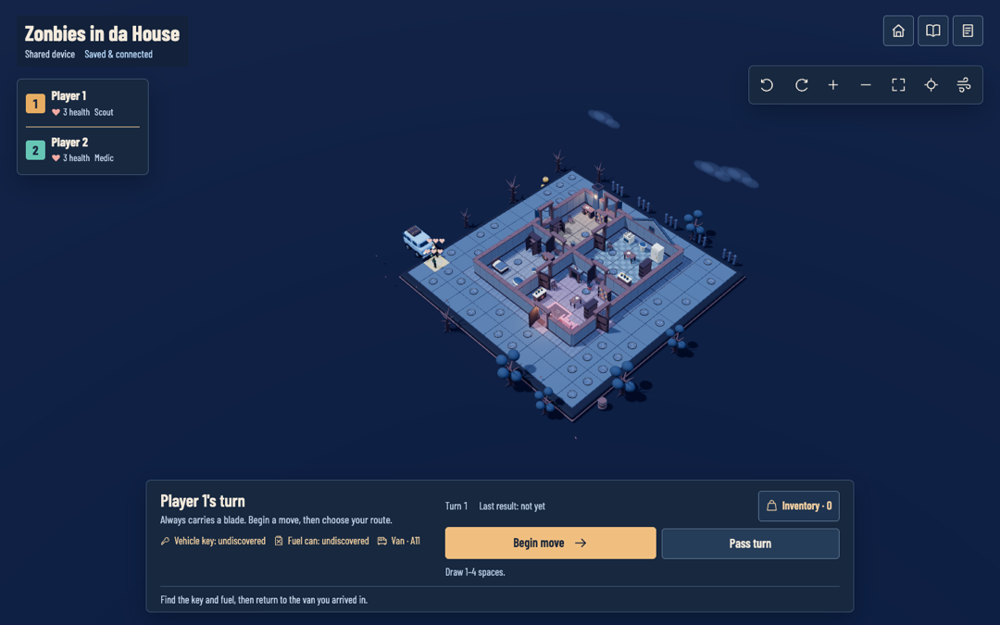
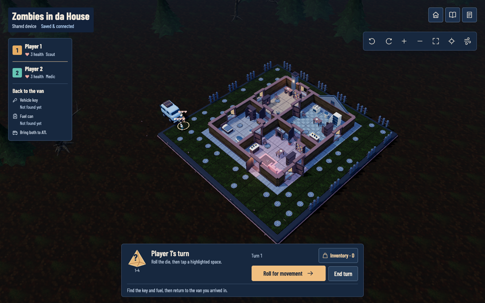
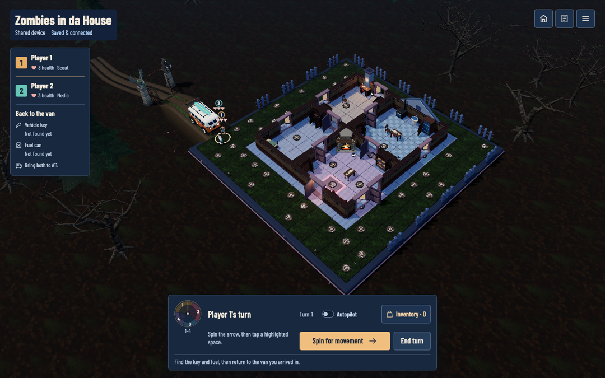
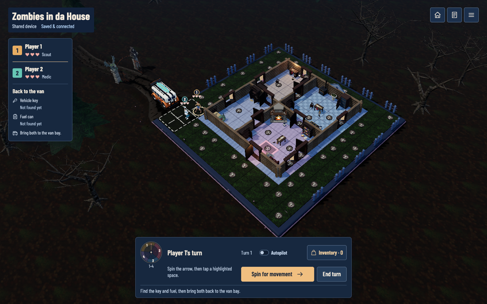
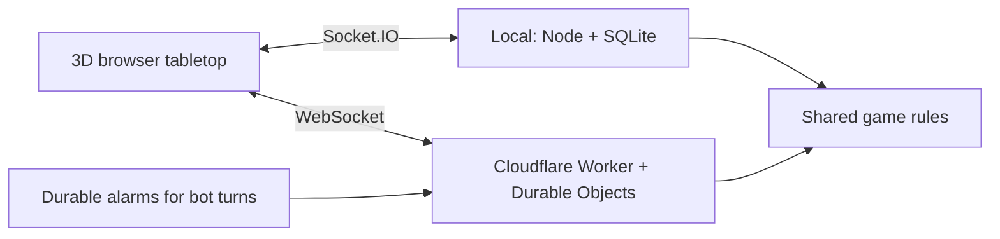

# Zombies in da House: from prototype to survival game

A browser tabletop game, inspired by a board game I like: explore a monster-filled house, find the
vehicle key and fuel, and decide when to escape.

**[Play the live demo](https://zombie-in-da-house.syntal.workers.dev)** · private source repository

Play solo or with friends online or on a shared device, with optional bots and
at most five survivors in total. Eliminated survivors control monsters while
someone remains alive.

## How it evolved

On 6 November at 18:34 I asked an agent whether we could make our own version of
a board game I liked. The first playable multiplayer build was committed at 22:18
the same evening, under four hours later, and the first cloud release followed the next morning. I built it
alongside other projects; with full focus it would have been faster.

The first prompt did not produce this game. Most changes came from playing it and
writing down what felt wrong: solo players could not move on their first turn,
hidden items near the fireplace were invisible, carried items looked unnatural.
Each round of play produced the next set of fixes.

| 6 Nov · first playable build | 7 Nov · first cloud release | 9 Nov · haunted house, bots in every mode |
| --- | --- | --- |
|  |  |  |
| **11 Nov · woods and pickup feedback** | **13 Nov · forest road, hearth, autopilot** | **15 Nov · log cabin and van bay** |
|  |  |  |

_Rebuilt on 15 November from the exact main-branch commits (f6e57cf, 14b2572,
48b47c9, f43711f, ff6dda9, 43a0044), not screenshots taken on those days. Each
shows turn one of a two-player shared-device game with the default camera. The
9 November release added bots, which this two-player view does not show._

**Lesson:** AI made the first version fast; playing it is what made it good.

## What this demonstrates

- **Server-authoritative multiplayer:** the service validates game actions and
  preserves saved outcomes across retries, reconnects, and runtime restarts.
- **Local and edge deployment:** the same game rules support Node with Socket.IO
  locally and Cloudflare Workers with Durable Objects online; durable alarms
  schedule bot turns.
- **Accessible 3D interaction:** an original browser tabletop combines animated
  models with keyboard controls and reduced-motion behavior.
- **AI-assisted product delivery:** hands-on development with coding agents,
  versioned builds, and exact-commit release checks.

The spinner shows the saved outcome rather than rerolling on refresh. The same
browser journeys run against Node and a local Worker, including reconnect,
lost-acknowledgement retry, solo play and cooperative bots.

_Personal project; opinions are my own. More: [github.com/vasilyevstan](https://github.com/vasilyevstan)_
