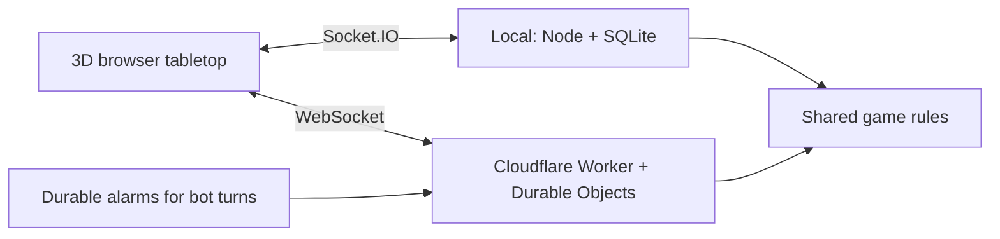

# Zombies in da House: real-time multiplayer at the edge

An original browser tabletop game: explore a monster-filled house, find the
vehicle key and fuel, and decide when to escape.

**[Play the live demo](https://zombie-in-da-house.syntal.workers.dev)** · private source repository

Play solo or with friends online or on a shared device, with optional bots and
at most five survivors in total. Eliminated survivors control monsters while
someone remains alive.

## What this demonstrates

- **Server-authoritative multiplayer:** the service validates game actions and
  preserves saved outcomes across retries, reconnects, and runtime restarts.
- **Local and edge deployment:** the same game rules support Node with Socket.IO
  locally and Cloudflare Workers with Durable Objects online; durable alarms
  schedule bot turns.
- **Accessible 3D interaction:** an original browser tabletop combines animated
  models with keyboard controls and reduced-motion behavior.
- **AI-assisted product delivery:** hands-on development with coding agents,
  versioned builds, and exact-commit release checks.

The spinner shows the saved outcome rather than rerolling on refresh. The same
browser journeys run against Node and a local Worker, including reconnect,
lost-acknowledgement retry, solo play and cooperative bots.

_Personal project; opinions are my own. More: [github.com/vasilyevstan](https://github.com/vasilyevstan)_
