# How Zombies in da House evolved

**[Play the live demo](https://zombie-in-da-house.syntal.workers.dev)** · private source repository

During COVID, many of us stayed at home through a time of uncertainty. Today it feels like the most stable and predictable time we ever had. Staying in, we played a lot of board games, and the idea for this game was born in that nostalgic feeling and spirit.

It became a browser tabletop with its own art, rules text and code: find the vehicle key and the fuel, get back to the van, and if you fall, play for the house. The first playable multiplayer build was committed on the first evening. Eighteen days later the game had reached v28.1; by v28.3, the van had gained rally flaps and a zombie-face logo.

Every picture on this page comes from the real code of its day. Each snapshot was checked out, built from scratch and played again with the same seed; nothing is a mock-up. See [How these pictures were made](#how-these-pictures-were-made). The Warden and the van, the two models redesigned most often, also get [a section of their own](#the-warden-and-the-van).

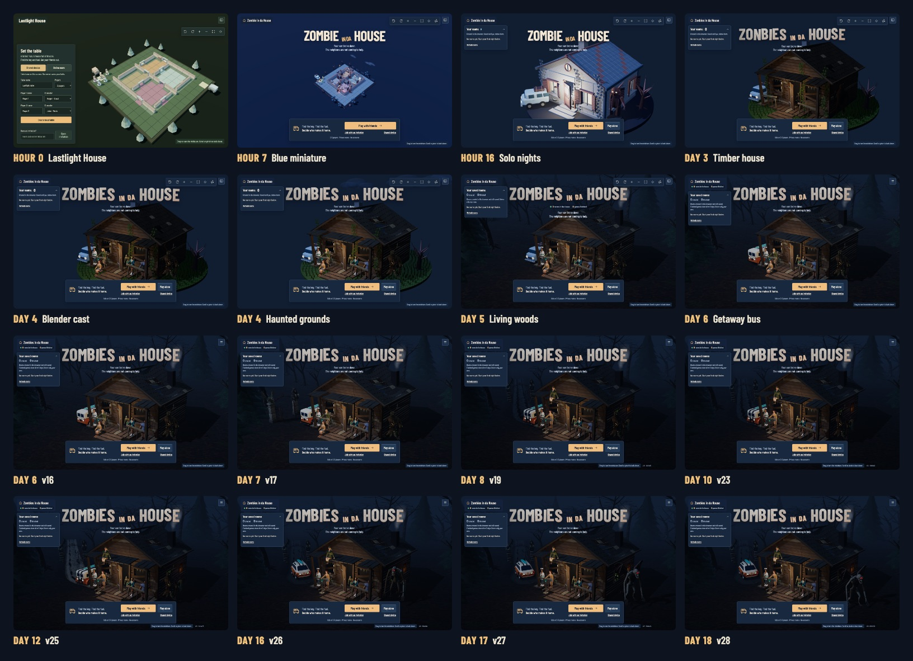

## At a glance

Time is counted from the first commit to each snapshot's merge to `main`: in hours on the first day, rounded to the nearest hour, then in days, where day 1 is the first 24 hours.

| When       | Snapshot                          | Changes                                  | Highlights                                                                        |
| ---------- | --------------------------------- | ---------------------------------------- | --------------------------------------------------------------------------------- |
| Hour 0     | Lastlight House, [`f6e57cf`]      | first commit                             | A playable multiplayer table: shared device or online room, spin to move.         |
| Hour 7     | Blue miniature, [`14b2572`]       | [#1], [#3]                               | The name, a moonlit furnished cutaway, invitations and the first cloud release.   |
| Hour 16    | Solo nights, [`bb9056f`]          | [#7]                                     | Play alone with up to four bot companions; your rooms on the homepage.            |
| Day 3      | Timber house, [`48b47c9`]         | [#9]                                     | A decaying wooden house, bots in every mode, the combat dial.                     |
| Day 4      | Blender cast, [`7439b82`]         | [#11], [#13]                             | Detailed survivors and monsters modeled in Blender.                               |
| Day 4      | Haunted grounds, [`75db377`]      | [#14]                                    | Compact hero selection and explicit turn controls.                                |
| Day 5      | Living woods, [`2b5cbea`]         | [#16], [#19], [#21]                      | Baked woods and trees, a burning hearth, house totals, a compact dock.            |
| Day 6      | Getaway bus, [`096a1f2`]          | [#23]                                    | Compact setup, one Menu button, monsters rising from the floor, the hippie bus.   |
| Day 6      | v16, [`ff88425`]                  | [#27]                                    | The original's weighted spinner, Autopilot, haunted gates.                        |
| Day 7      | v17–v18, [`ff6dda9`], [`b1fc5e0`] | [#29], [#31]                             | Arrival and departure cutscenes, the Hall of Fame, rescues, the Bazooka.          |
| Day 8      | v19, [`06749f5`]                  | [#33]                                    | The van bay, a log cabin, a sunken road, four cutscenes.                          |
| Days 8–10  | v20–v23, [`1389669`]              | [#38], [#40], [#42], [#44]               | Roster hearts, a last stand, mood-matched music, discs on every hidden cell.      |
| Days 11–12 | v24–v25, [`0d1ae73`]              | [#48], [#50]                             | The rulebook map, a Blender gravel road, clean music handoffs.                    |
| Days 12–16 | v26, [`84bd0de`]                  | [#52], [#56], [#60], [#64], [#66], [#68] | Smarter bots, a smooth entrance, a scene for every fall, an aerodynamic van.      |
| Day 17     | v27, [`06dba2a`]                  | [#70]                                    | IDDQD and IDKFA, a winged Warden, checkmarks for survivors who reach the van.     |
| Day 18     | v28, [`0504769`]                  | [#72]                                    | No cheated games in the Hall of Fame, readable supplies, a Warden that walks.     |
| Day 19     | v28.1, [`f2f6e31`]                | [#78]                                    | A sports kit for the van: a GT wing, carbon aero and stripes from nose to tail.   |
| Day 19     | v28.2, [`556ae2e`]                | [#83], [#84]                             | Cream-striped rally flaps; the story now opens with the COVID stay-at-home years. |
| Day 19     | v28.3, [#87]                      | [#87]                                    | Black rubber flaps with a raised bone zombie skull and ZOMBIES wordmark.          |

## Hour 0 — Lastlight House

Snapshot [`f6e57cf`], the first commit.

The very first build was called **Lastlight House**: a pale green, low-poly table with pastel rooms, face-down tiles and a few white trees. You set the table for a shared device or an online room, named two survivors and pressed **Spin movement**. The van is broken; find the key and the fuel. It looked like a prototype, but the engine underneath was already serious: authoritative multiplayer, inventory and rules on the server.

<p>
  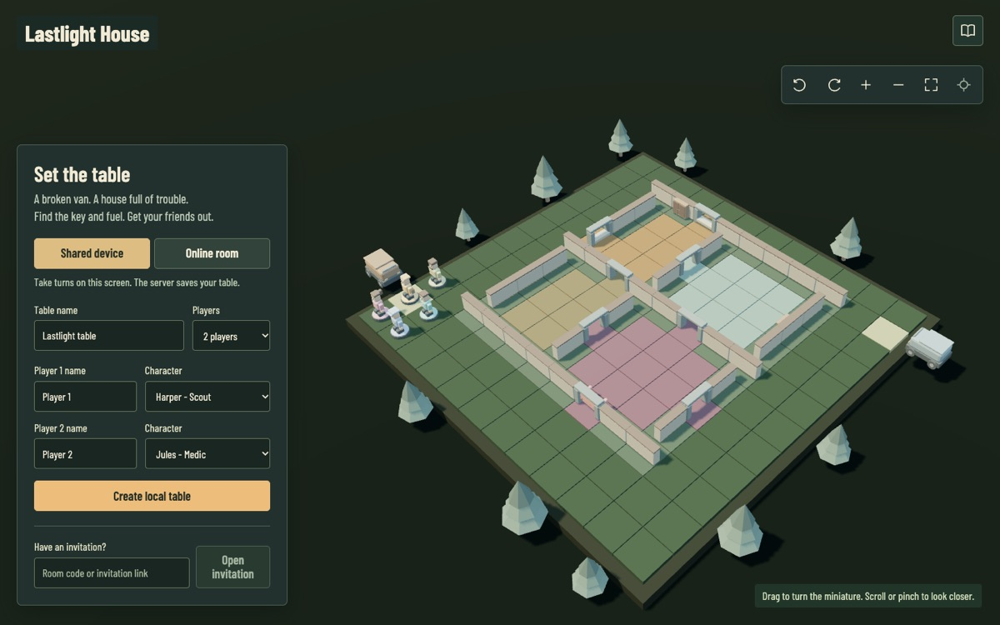
  
</p>

## Hour 7 — the blue miniature

Snapshot [`14b2572`] · [#1] and [#3], promoted in [#2].

Overnight the game got its name, **Zombie in da House**, and its look: a blue, moonlit miniature of the house in cutaway. [#1] added invitations — **Play with friends**, **Join with an invitation** or pass a **Shared device** — for two to five players in private rooms, with no accounts. [#3] furnished it: a study, kitchen, bedroom and living room with searchable furniture, and windows you can climb through, all from an original 61-prefab model kit. This snapshot was the first cloud release.

<p>
  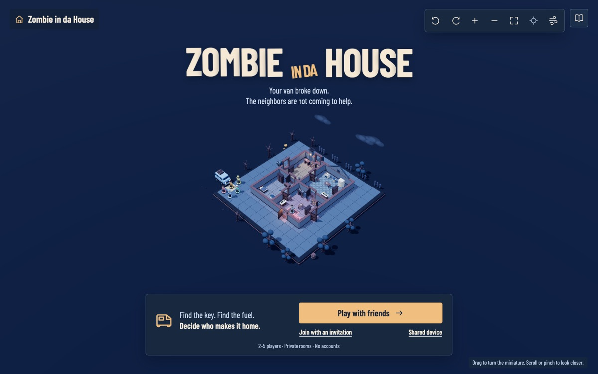
  
</p>

## Hour 16 — solo nights

Snapshot [`bb9056f`] · [#7], promoted in [#8].

Nine hours later came a real one-survivor night: **Play alone** with zero to four bot companions, five survivors at most. Bots make one paced decision at a time through the same strict server path as people. The homepage gained **Your rooms** to resume or delete the rooms you created, and the landing page finally showed a roofed haunted house. The setup still used the first, blocky figures.

<p>
  
  
</p>

## Day 3 — the timber house

Snapshot [`48b47c9`] · [#9], promoted in [#10].

The brief: a frightening, decaying wooden house with natural green grass, a scary title and Mortal Kombat-style ability showcases on the selection screen. The house became weathered timber in the grass. Bots could now join every kind of table, fights got a combat arrow as a dial, and Cloudflare Web Analytics began counting page views. The wordmark in this snapshot reads “ZONBIES in da HOUSE”; [#13] changed it to “ZOMBIES” 21 hours later. Two independent reviews accepted the house but sent the cast back for a rebuild — which is what happened next.


## Day 4 — the Blender cast

Snapshot [`7439b82`] · [#11] and [#13], promoted in [#12].

Every figure was rebuilt in Blender: five adult survivors with 12,600–13,600-vertex heads, baked face textures, styled hair and role props (a blade, a carbine, a first-aid case, a riot shield), and four new monsters — a hound, a crawler, the Warden and a Shambler. The exported kit weighed 27.4 MB, over Cloudflare's 25 MiB per-file limit, so [#11] mesh-quantized it to 18.9 MB; with [#13]'s refined cast the shipped kit reached 25.5 MB, still under the limit. On the landing page the survivors now wait on the porch.

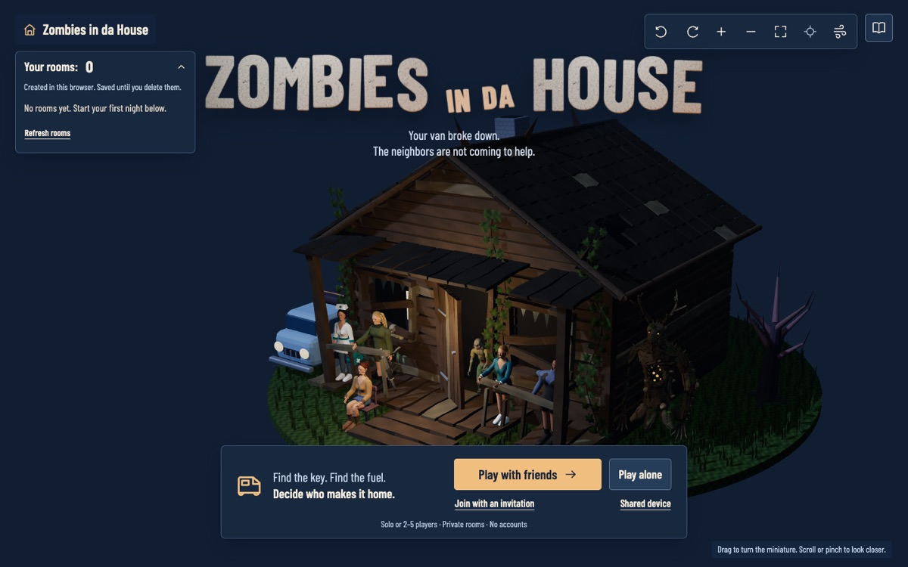

## Day 4 — haunted grounds

Snapshot [`75db377`] · [#14], promoted in [#15].

Three hours later, hero selection moved into a compact panel — “Your place in the story” — beside the haunted scene. A shambler patrols the verge, and each turn gained an explicit **Roll for movement** step.

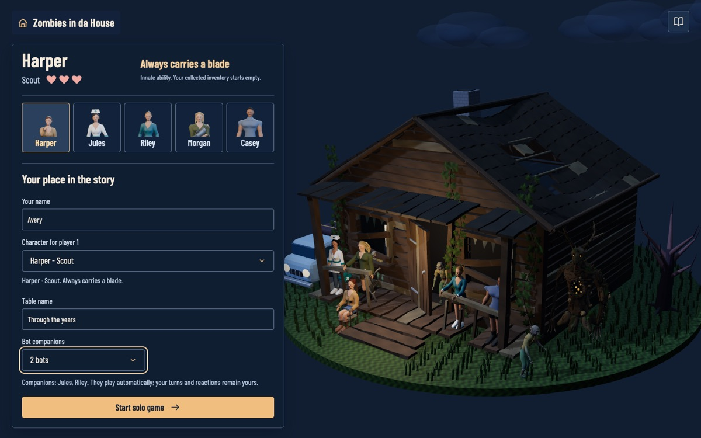

## Day 5 — the living woods

Snapshot [`2b5cbea`] · [#16], [#19] and [#21], promoted in [#18], [#20] and [#22].

The house moved into the woods. Grass, forest floor, bark and clapboard textures were baked in Blender's Cycles renderer, and five procedural trees — three dead, two spruce — ring the clearing and hide whenever they would block the camera. The game board now matches the landing house. A pickup flyout shows what you found, and a pill under the title counts the rooms in the house and the games finished. The chimney smokes, the fireplace burns and monsters wander among the trees outside the fence. The turn dock became compact, with forgiving phone taps. This release was also the first whose checks ran on the owner's disposable Azure VMs.

<p>
  
  
</p>

## Day 6 — the getaway bus

Snapshot [`096a1f2`] · [#23], promoted in [#24].

A batch of play-testing notes. Setup shrank to one compact panel with a random scary table name, and the floating toolbar became a single **Menu** button. Furniture snapped to the walls. A hidden monster now stays underground until a survivor is one cell away, then rises out of the floor; defeated monsters topple and stay as ashen bodies. The van became an orange-and-white hippie getaway bus.

<p>
  
  
</p>

## Day 6 — v16: the faithful spinner

Snapshot [`ff88425`] · [#27], promoted in [#28].

The first release with a version in its name. The movement spinner now has weighted sectors in 3:3:2:2 shares. **Autopilot** lets a bot take your seat until you take control again. A forest road with haunted gates and figurine posts leads to the van, an old corner hearth replaced the fireplace, and finished rooms sort last. Before any code was written, the plan was argued by two AI models, one challenging and one defending it.


## Day 7 — v17 and v18: cutscenes and the Hall of Fame

Snapshot [`ff6dda9`] (v17) · [#29], promoted in [#30]; v18 in [#31], promoted in [#32].

The game turned cinematic, with an arrival scene as the van pulls in and a departure as it escapes. The road became a swamp of puddles and ruts, the gate figurines became a detailed horned gargoyle and a clawed hooded ghoul with ember eyes, and an antique furniture kit arrived, with a car key that finally looks like a car key. Gameplay added the **Hall of Fame**, game timing and optional rescues, and the Flare Launcher became the Bazooka. Sixteen hours later v18 fixed an arrival scene that did not play when a game started; our rebuild of v17 shows the same symptom. v18 also muddied the road, broke the antiques and added cutscene previews and an escape prompt.


## Day 8 — v19: the van bay

Snapshot [`06749f5`] · [#33], promoted in [#34].

v19 settled how heroes share the board: they may pass through each other but never stop on the same space, except on the truck at the finish. Instead of stacking, the finish got a real **van bay**, a 2×3 pad beside the van. Nobody shares a space anywhere, everyone starts in the bay, and the survivors standing in it escape together once they hold the key and the fuel. The house became a log cabin, the road sank into the ground and the arrival scene splashes mud. There were now four cutscenes.


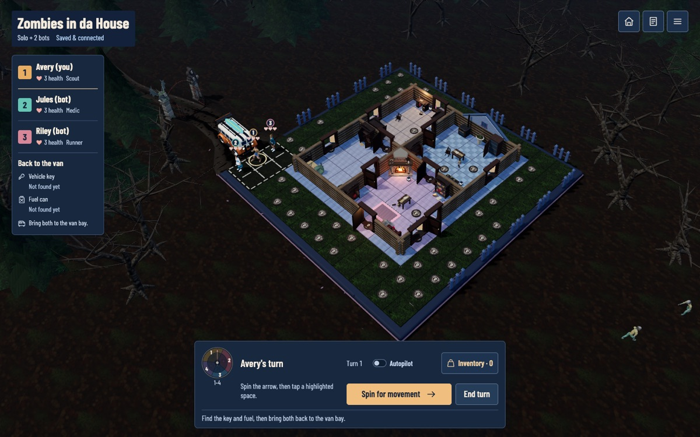

## Days 8–10 — v20 to v23: hearts, scores and discs

Snapshot [`1389669`] (v23) · [#38], [#40], [#42] and [#44], promoted in [#39], [#41], [#43] and [#45].

Four releases in 33 hours:

- **v20:** Board up, Break and Grenade became compact buttons beside **End turn**, and a rules check confirmed that the medkit has no health cap, as in the rulebook.
- **v21:** one heart per health point in the roster, a last-stand cutscene when the final survivor falls, and a haunted score with sound switches.
- **v22:** cutscene music matched to the mood, every seat can move on turn 1, and every hidden marker is visible.
- **v23:** a disc on every hidden cell (an audit found that furnished cells had none), a bazooka sling, barricades at any point of your own turn, and a landing theme.

The landing page barely changed in these days; see the contact sheet above.

## Days 11–12 — v24 and v25: the rulebook map

Snapshot [`0d1ae73`] (v25) · [#48] and [#50], promoted in [#49] and [#51].

v24 hid discs behind walls, held “found” news until the finder arrives and steadied **Take control**. v25 matched the yard and the encounter deck to the rulebook, replaced the road with Blender-baked gravel and a driveway that runs up to the bay, gave each soundtrack a clean reverb fade, and fitted piles of recovered items onto small screens. Browser tests split into a Node job and a Cloudflare job.

<p>
  
  
</p>

## Days 12–16 — v26: smarter bots and a long polish

Snapshot [`84bd0de`] · [#52], [#56], [#60], [#64], [#66] and [#68], each promoted to `main`.

v26.0.0 taught bots to route around revealed monsters and to stand still rather than take a pointless step ([#52]). The next four and a half days were play-testing polish under the same version number:

- The arrival is fully prepared before it plays, so the entrance no longer stutters. The same release brought a new many-eyed Warden and dates in the Hall of Fame ([#56]).
- You can board up only a door or window beside you ([issue #58]), and every fallen survivor gets their own scene ([issue #59]). Both shipped in [#60], together with a darker driveway.
- The table stays as you left it after a mid-game death scene ([#64]).
- The Hall of Fame shows the time, the Warden's reveal no longer freezes the game, walkers in the woods keep their feet on the ground and the van got rounder ([#66]).
- The landing camera tilts from nearly overhead down to eye level, and the van became an aerodynamic one-box ([#68]).

<p>
  
  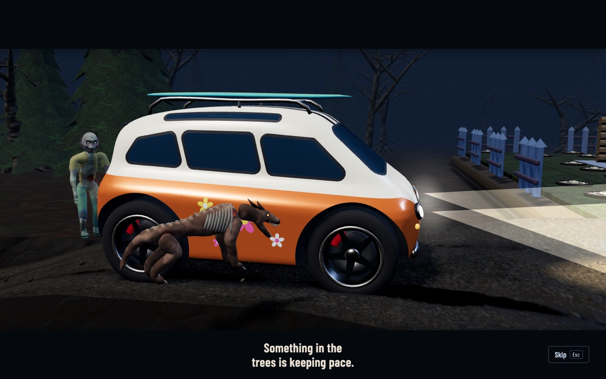
</p>

## Day 17 — v27: cheat codes

Snapshot [`06dba2a`] · [#70], promoted in [#71].

Old-school cheats arrived. Type `iddqd` and your survivor can no longer die: their hearts become a golden infinity sign modeled in Blender, and everyone at the table sees it. Type `idkfa` and you alone see what lies under every plate. Monsters and items appear as pale ghosts, neither discovered nor activated, so nobody playing for the undead can use them early. The Warden grew vampire wings. Survivors who reach the van get a checkmark beside their name, a bot that stopped one cell short of the bay now walks in, and on small screens the roster and the turn dock no longer hide each other.

<p>
  
  
</p>

## Day 18 — v28: a Warden that walks

Snapshot [`0504769`] · [#72], promoted in [#73].

Games played with a cheat no longer enter the Hall of Fame. The supplies were remodeled in Blender — an X-braced plank barricade, a jerry can and a van key with a tag — so they read at a glance, even as IDKFA ghosts; compare the flat slabs in v27 above. And the Warden finally walks: an armature lets it knuckle-walk on its arms with planted feet, in the woods, on the board and in cutscenes.

<p>
  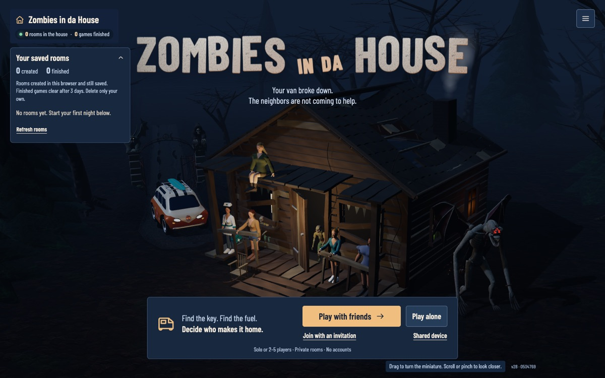
  
</p>

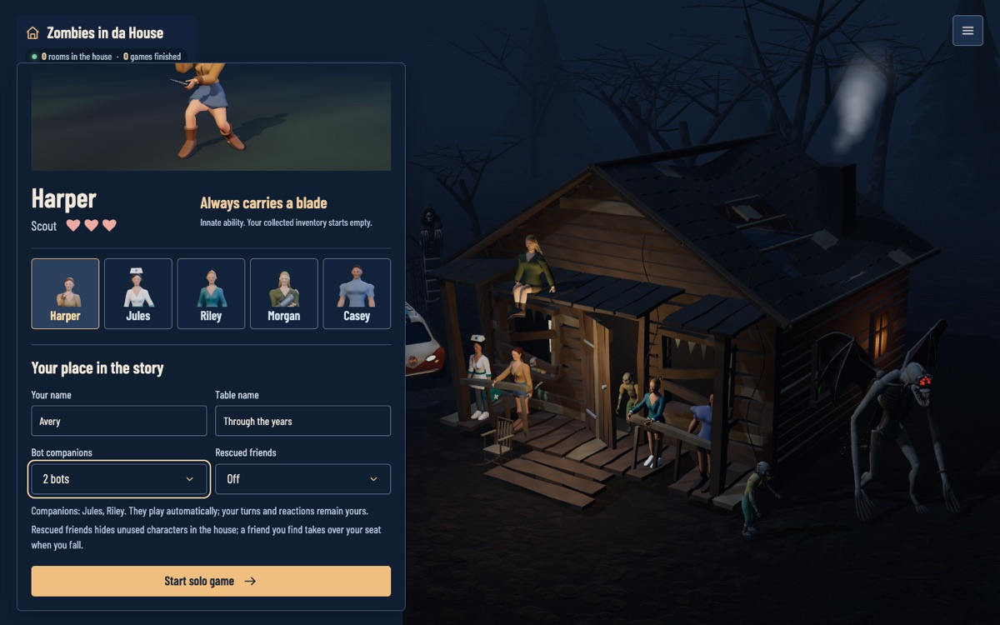

## Day 19 — v28.1: the sports kit

Snapshot [`f2f6e31`] · [#78], promoted in [#79].

A day later the one-box van got a sports kit from the same Blender script: a cream GT wing with stripes, on raked carbon pylons between flat carbon endplates, with a Gurney flap and a third brake lamp; a carbon splitter edged in sunset orange, an air dam, side skirts, a five-fin diffuser, and stripes from nose to tail. The body, wheels and outline did not change, so the van parks, drives and takes on survivors exactly as before.

<p>
  
  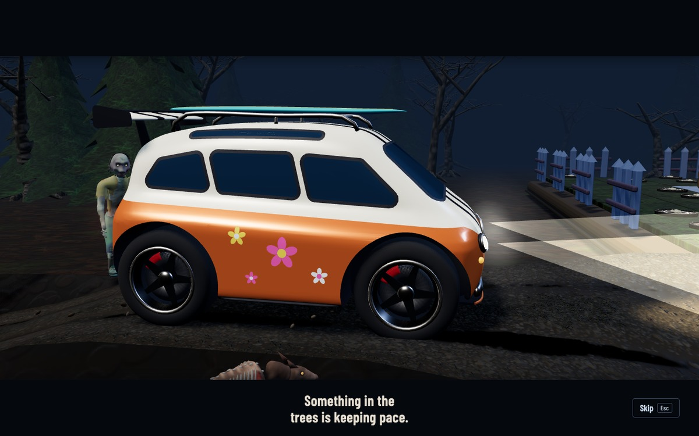
</p>

## Day 19 — v28.2–v28.3: rally flaps, then a zombie mark

Snapshots [`556ae2e`] and [#87]; v28.2 in [#83] and [#84], promoted in [#85], then v28.3 in [#87].

v28.2 added striped cream rally flaps behind the rear tyres, braced on carbon stays. The next revision changed them to matte black and added a raised bone skull with the game's ZOMBIES wordmark. The shape, clearances and wheel positions stayed the same; the launch rooster tails now spray from behind the flaps.

<p>
  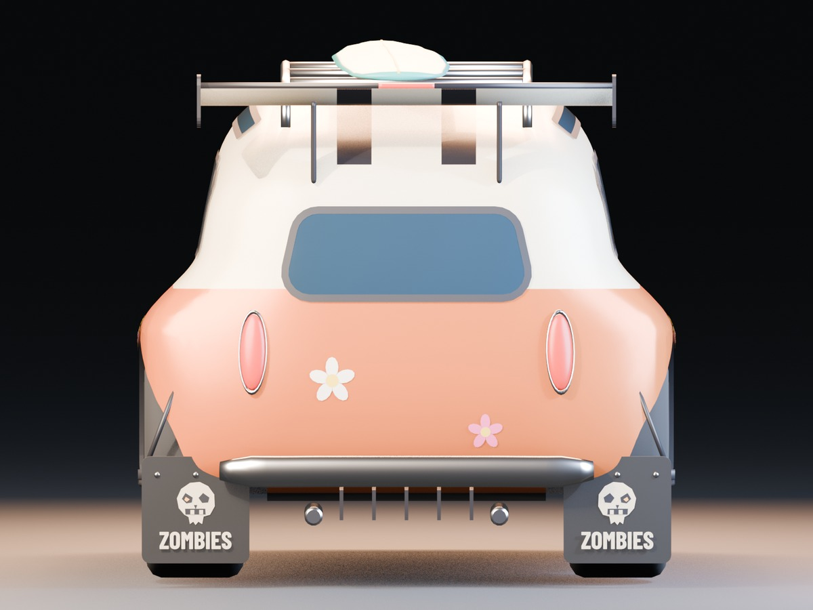
</p>

## The Warden and the van

Two models were redesigned again and again: the Warden, the house's boss monster, and the van you need to escape in. The lineups show their major shape versions; the latest smaller refinements are recorded in the timeline above. Each is rendered from its own model file under the same studio light and camera, so the models can be compared side by side; in the game they sit in darker light.

### The Warden

The Warden has had eight looks. After its Blender rebuild on day 4 it stayed the same for about ten days, then changed three times in under four days.


| When    | What changed                                                                                                                                                                       | Source      |
| ------- | ---------------------------------------------------------------------------------------------------------------------------------------------------------------------------------- | ----------- |
| Hour 0  | A blocky antlered figure on a round plinth.                                                                                                                                        | [`f6e57cf`] |
| Hour 7  | The moonlit model kit: a rounded body, glowing eyes and branching antlers.                                                                                                         | [#3]        |
| Hour 16 | A dark open mouth and loose slats hanging over its chest.                                                                                                                          | [#7]        |
| Day 3   | A gaunt, horned figure with a skull face and a newly jointed head.                                                                                                                 | [#9]        |
| Day 4   | Rebuilt in Blender as a timber giant of roots and splinters, with antlers, an ember heart and teeth.                                                                               | [#11]       |
| Day 14  | The many-eyed giant from [`warden_model.py`](https://github.com/vasilyevstan/zombie-boardgame/blob/deaa3973d04eb0a919a9074f65ca7e29739beff6/assets/blender/warden_model.py): nine eyes, a needle maw, ribs, overlong clawed arms, a shroud, a shackle and a chain.             | [#56]       |
| Day 17  | v27: vampire wings that stir with each breath and flare forward every few seconds.                                                                                                 | [#70]       |
| Day 18  | v28, 22 hours later: an armature lets it knuckle-walk, using its arms as front legs with planted claws, in the woods, on the board and in cutscenes. The tile shows it mid-stride. | [#72]       |

### The van

The lineup captures eight major shape versions, ending with the sports kit. The blue van of hour 7 lasted about five days. The hippie bus that replaced it got sportier twice on day 7, sixteen hours apart, and on day 16 a Blender script rebuilt it twice, twelve hours apart. On day 19, the one-box got a sports kit; v28.2 and v28.3 then refined its rear mud flaps.


| When   | What changed                                                                                                                       | Source      |
| ------ | ---------------------------------------------------------------------------------------------------------------------------------- | ----------- |
| Hour 0 | A pastel box on octagonal wheels.                                                                                                  | [`f6e57cf`] |
| Hour 7 | A pale blue van with a bedroll on the roof rack, round lamps, a grille and a bumper.                                               | [#3]        |
| Day 6  | An orange-and-white hippie getaway bus with flowers and a surfboard.                                                               | [#23]       |
| Day 7  | v17: a spoiler, fender flares and separate wheels.                                                                                 | [#29]       |
| Day 7  | v18: an aero kit, brake calipers and rotors, an exhaust and stripes.                                                               | [#31]       |
| Day 16 | Rebuilt from a Blender script, [`van_model.py`](https://github.com/vasilyevstan/zombie-boardgame/blob/deaa3973d04eb0a919a9074f65ca7e29739beff6/assets/blender/van_model.py), as a rounder van with a peace sign.               | [#66]       |
| Day 16 | An aerodynamic one-box with a teardrop body, wrap-around glass and deep-dish wheels.                                               | [#68]       |
| Day 19 | v28.1: a sports kit — a cream GT wing between carbon endplates, a splitter, side skirts, a diffuser and stripes from nose to tail. | [#78]       |
| Day 19 | v28.2: striped cream flaps behind the rear tyres on carbon stays.                                                                  | [#83]       |
| Day 19 | v28.3: matte-black flaps with a raised zombie skull and ZOMBIES wordmark.                                                          | [#87]       |

## Behind the scenes

- After the first commit, every change went through a pull request to `dev`, then reached `main` in a promotion pull request; v28.1 arrived in the 34th.
- By day 4 ([#11]) the suite had 34 unit tests, 16 integration tests and 12 browser journeys on each transport. With v28.1 it has 78 unit tests, 24 integration tests and 34 browser journeys, run both on Node and on the Cloudflare Worker.
- The game runs in production at <https://zombie-in-da-house.syntal.workers.dev>.

## How these pictures were made

Each snapshot is the `main` commit named in its chapter (a merge commit, except the first commit), rebuilt from scratch for this page:

```sh
git worktree add --detach /tmp/zidh-history/wt <commit>
cd /tmp/zidh-history/wt && npm ci && npm run build
NODE_ENV=test TEST_GAME_SEED=17 HOST=127.0.0.1 PORT=4290 \
  PUBLIC_APP_URL=http://127.0.0.1:4290 DATABASE_PATH=/tmp/zidh-history/<snapshot>.sqlite \
  node dist/server.js
```

- Every snapshot ran locally on Node with a fresh SQLite database and seed 17, so each build deals its own table reproducibly. The deck itself changed over time.
- Playwright drove Chromium with hardware WebGL (ANGLE on Metal, Apple silicon) at 1440×900. It opened the landing page and started a solo game with two bot companions. The first two snapshots predate solo play, so there it set a two-player shared-device table. It captured or skipped the arrival cutscene, then waited for the board.
- The cheat shots type `iddqd`, then `idkfa`, on the board and zoom in four steps.
- None of the 17 builds logged a console error.
- Later landing pages carry a build stamp in the footer. The date of our rebuild was painted out of it, leaving the version and commit.
- The lineups are studio renders of each version's own model file from the repository history, made with three.js r187 under one light rig and camera angle; only self-lit parts such as lamps and eyes glow. The walking Warden is posed mid-stride by the game's own gait code. They show the models, not the game's lighting.
- Screenshots are 1200-pixel JPEGs; the contact sheet is a montage of the 16 landing pages.

[`f6e57cf`]: https://github.com/vasilyevstan/zombie-boardgame/commit/f6e57cfebff643989ff1c4c9a30b7eb1276b67c2
[`14b2572`]: https://github.com/vasilyevstan/zombie-boardgame/commit/14b25727de8e02e4ff196ad76dc7800dedfd129c
[`bb9056f`]: https://github.com/vasilyevstan/zombie-boardgame/commit/bb9056f1e3ad643fd4bc44a9235b5ab53260b091
[`48b47c9`]: https://github.com/vasilyevstan/zombie-boardgame/commit/48b47c91a9fc69770403902de21128e488eee0ec
[`7439b82`]: https://github.com/vasilyevstan/zombie-boardgame/commit/7439b82a5b0a042291b1ca72d13e8b159f50d103
[`75db377`]: https://github.com/vasilyevstan/zombie-boardgame/commit/75db3772d9aaf56abfeda72a380dbb4e051f5f33
[`2b5cbea`]: https://github.com/vasilyevstan/zombie-boardgame/commit/2b5cbeae401fa733c7ee5cf31fa8df24dbb322b9
[`096a1f2`]: https://github.com/vasilyevstan/zombie-boardgame/commit/096a1f2ff6f3484760676dcb33b7acf799827d64
[`ff88425`]: https://github.com/vasilyevstan/zombie-boardgame/commit/ff8842519b52339b42b52db8cac0ffc6313880af
[`ff6dda9`]: https://github.com/vasilyevstan/zombie-boardgame/commit/ff6dda906ea0b5b2fdfc529c730366be4def16cb
[`b1fc5e0`]: https://github.com/vasilyevstan/zombie-boardgame/commit/b1fc5e08831376c10190a2e111027046d35d2d1f
[`06749f5`]: https://github.com/vasilyevstan/zombie-boardgame/commit/06749f57c85de78fbf87f82bafcc1796b8535c18
[`1389669`]: https://github.com/vasilyevstan/zombie-boardgame/commit/1389669dee43e945e34c335b9c4b4b1241874080
[`0d1ae73`]: https://github.com/vasilyevstan/zombie-boardgame/commit/0d1ae73dda076a87a8f4a8aa89633f9fb8ee5aef
[`84bd0de`]: https://github.com/vasilyevstan/zombie-boardgame/commit/84bd0debf1e4707bf59cc28d0a178f7c54dc321a
[`06dba2a`]: https://github.com/vasilyevstan/zombie-boardgame/commit/06dba2a2078f1d884ae101612b63cb9ccb7b2aa8
[`0504769`]: https://github.com/vasilyevstan/zombie-boardgame/commit/05047697142be180f89a369ef6a999716209d4eb
[`f2f6e31`]: https://github.com/vasilyevstan/zombie-boardgame/commit/f2f6e31e690482530d01d4fe4c2912b112691a68
[`556ae2e`]: https://github.com/vasilyevstan/zombie-boardgame/commit/556ae2e09a95a69c4eeff6cd7f91812a7631644c
[#1]: https://github.com/vasilyevstan/zombie-boardgame/pull/1
[#2]: https://github.com/vasilyevstan/zombie-boardgame/pull/2
[#3]: https://github.com/vasilyevstan/zombie-boardgame/pull/3
[#7]: https://github.com/vasilyevstan/zombie-boardgame/pull/7
[#8]: https://github.com/vasilyevstan/zombie-boardgame/pull/8
[#9]: https://github.com/vasilyevstan/zombie-boardgame/pull/9
[#10]: https://github.com/vasilyevstan/zombie-boardgame/pull/10
[#11]: https://github.com/vasilyevstan/zombie-boardgame/pull/11
[#12]: https://github.com/vasilyevstan/zombie-boardgame/pull/12
[#13]: https://github.com/vasilyevstan/zombie-boardgame/pull/13
[#14]: https://github.com/vasilyevstan/zombie-boardgame/pull/14
[#15]: https://github.com/vasilyevstan/zombie-boardgame/pull/15
[#16]: https://github.com/vasilyevstan/zombie-boardgame/pull/16
[#18]: https://github.com/vasilyevstan/zombie-boardgame/pull/18
[#19]: https://github.com/vasilyevstan/zombie-boardgame/pull/19
[#20]: https://github.com/vasilyevstan/zombie-boardgame/pull/20
[#21]: https://github.com/vasilyevstan/zombie-boardgame/pull/21
[#22]: https://github.com/vasilyevstan/zombie-boardgame/pull/22
[#23]: https://github.com/vasilyevstan/zombie-boardgame/pull/23
[#24]: https://github.com/vasilyevstan/zombie-boardgame/pull/24
[#27]: https://github.com/vasilyevstan/zombie-boardgame/pull/27
[#28]: https://github.com/vasilyevstan/zombie-boardgame/pull/28
[#29]: https://github.com/vasilyevstan/zombie-boardgame/pull/29
[#30]: https://github.com/vasilyevstan/zombie-boardgame/pull/30
[#31]: https://github.com/vasilyevstan/zombie-boardgame/pull/31
[#32]: https://github.com/vasilyevstan/zombie-boardgame/pull/32
[#33]: https://github.com/vasilyevstan/zombie-boardgame/pull/33
[#34]: https://github.com/vasilyevstan/zombie-boardgame/pull/34
[#38]: https://github.com/vasilyevstan/zombie-boardgame/pull/38
[#39]: https://github.com/vasilyevstan/zombie-boardgame/pull/39
[#40]: https://github.com/vasilyevstan/zombie-boardgame/pull/40
[#41]: https://github.com/vasilyevstan/zombie-boardgame/pull/41
[#42]: https://github.com/vasilyevstan/zombie-boardgame/pull/42
[#43]: https://github.com/vasilyevstan/zombie-boardgame/pull/43
[#44]: https://github.com/vasilyevstan/zombie-boardgame/pull/44
[#45]: https://github.com/vasilyevstan/zombie-boardgame/pull/45
[#48]: https://github.com/vasilyevstan/zombie-boardgame/pull/48
[#49]: https://github.com/vasilyevstan/zombie-boardgame/pull/49
[#50]: https://github.com/vasilyevstan/zombie-boardgame/pull/50
[#51]: https://github.com/vasilyevstan/zombie-boardgame/pull/51
[#52]: https://github.com/vasilyevstan/zombie-boardgame/pull/52
[#56]: https://github.com/vasilyevstan/zombie-boardgame/pull/56
[#60]: https://github.com/vasilyevstan/zombie-boardgame/pull/60
[#64]: https://github.com/vasilyevstan/zombie-boardgame/pull/64
[#66]: https://github.com/vasilyevstan/zombie-boardgame/pull/66
[#68]: https://github.com/vasilyevstan/zombie-boardgame/pull/68
[#70]: https://github.com/vasilyevstan/zombie-boardgame/pull/70
[#71]: https://github.com/vasilyevstan/zombie-boardgame/pull/71
[#72]: https://github.com/vasilyevstan/zombie-boardgame/pull/72
[#73]: https://github.com/vasilyevstan/zombie-boardgame/pull/73
[#78]: https://github.com/vasilyevstan/zombie-boardgame/pull/78
[#79]: https://github.com/vasilyevstan/zombie-boardgame/pull/79
[#83]: https://github.com/vasilyevstan/zombie-boardgame/pull/83
[#84]: https://github.com/vasilyevstan/zombie-boardgame/pull/84
[#85]: https://github.com/vasilyevstan/zombie-boardgame/pull/85
[#87]: https://github.com/vasilyevstan/zombie-boardgame/pull/87
[issue #58]: https://github.com/vasilyevstan/zombie-boardgame/issues/58
[issue #59]: https://github.com/vasilyevstan/zombie-boardgame/issues/59
