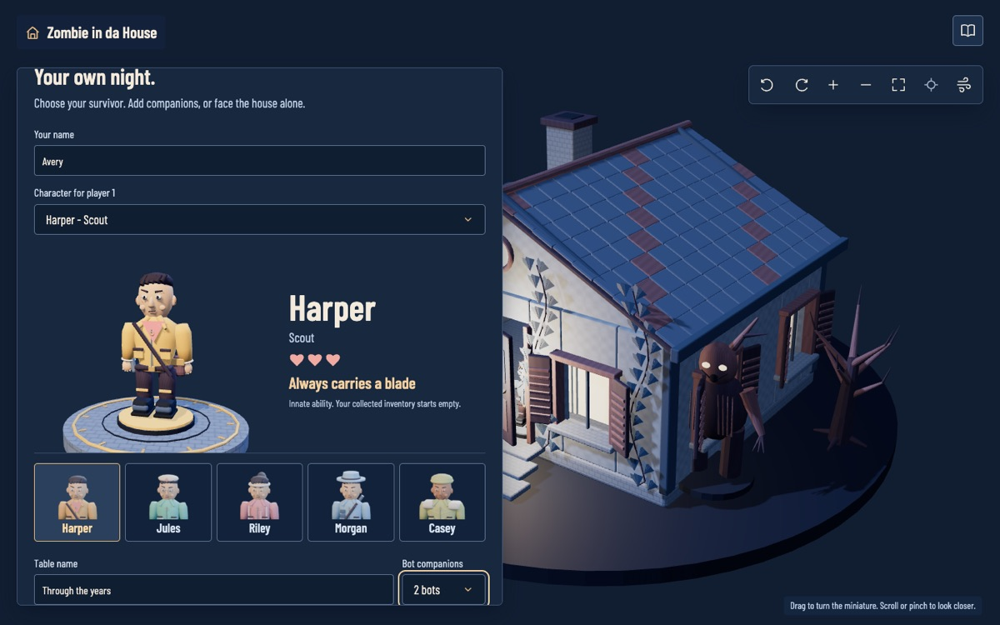
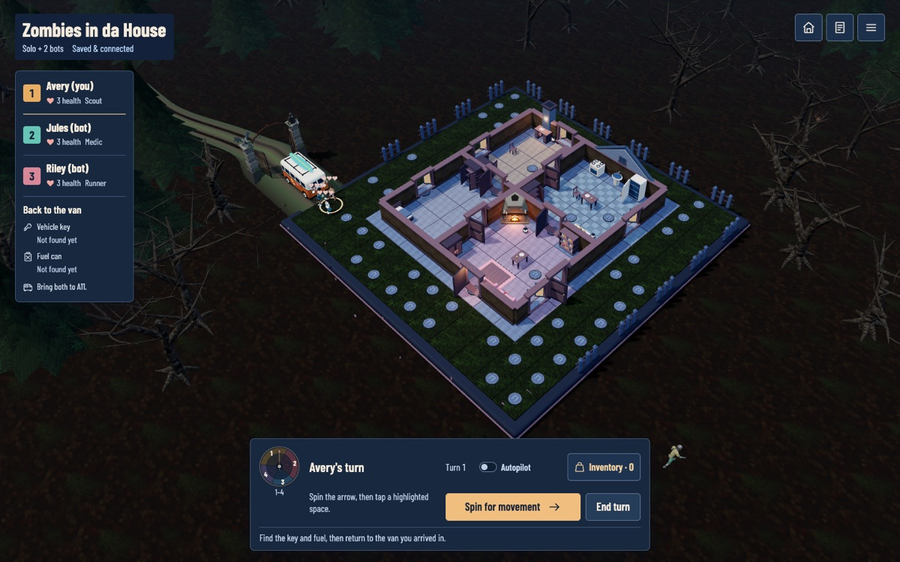
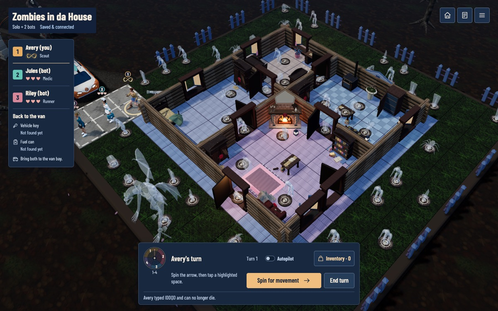
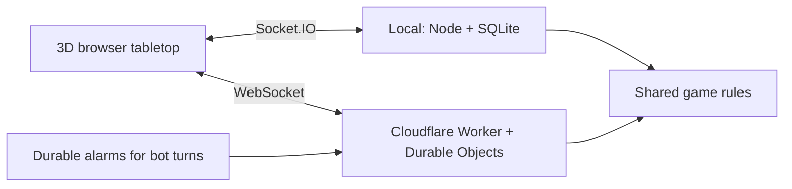

# How Zombies in da House evolved

A browser tabletop game, inspired by a board game I like: explore a monster-filled house, find the
vehicle key and fuel, and decide when to escape.

**[Play the live demo](https://zombie-in-da-house.syntal.workers.dev)** · private source repository

Play solo or with friends online or on a shared device, with optional bots and
at most five survivors in total. Eliminated survivors control monsters while
someone remains alive.

## How it evolved

Three hours and 44 minutes after I set out to make my own version of a board game I liked,
two people could play it. The house was a pale green board with face-down tiles.
It already had the rule the rest of the game would grow around: find the key and the fuel,
then get back to the van. The first cloud release followed the next morning.

_Read left to right, top to bottom: sixteen snapshots through v28, less than three weeks
after the first playable build. The pictures here come from the game's illustrated
history. They were captured by rebuilding and playing the original revisions, not on release day._

### The first ten days

In the first build two people shared a device or joined an online room. Bot companions
made a solo game possible, but playing alone uncovered a more basic problem: the survivor
could start in the middle and lose their first move. The escape needed attention too.
Instead of piling the survivors onto a single square, I gave the van a six-space bay.
Players could see who was there to escape together.

| First playable board | First cloud release | Solo play with bot companions |
| --- | --- | --- |
|  |  |  |
| **The house moves into the woods** | **v16: spinner and Autopilot** | **v19: a place to escape together** |
|  |  |  |

### What the landing pages don't show

By v26 a bot could route around a monster it had already seen. It could also choose
to stand still. Later I had to fix a bot that stopped one square short of the van:
almost reaching the exit doesn't get a survivor out.

One of the clearest lessons came from an optional cheat in v27. It let a player peek
under the face-down tiles without turning them over. It worked, but some supplies
looked like flat slabs. What use is seeing the board if you can't tell the fuel from
the key? In v28 the fuel became a jerry can and the key got a tag. Games played
with cheats no longer counted toward the Hall of Fame.

| v27: supplies revealed | v28: the same kind of reveal |
| --- | --- |
|  |  |

_Both boards were replayed locally from their release revisions with the reveal enabled._

**What I learned:** AI helped me get a multiplayer game onto the table in an evening.
Once I could play it, I had a better guide for the next change: watch where a player
gets stuck. Sometimes the game needed a different rule. Sometimes the key just
needed to look like a key.

## What this demonstrates

- **Server-authoritative multiplayer:** the service validates game actions and
  preserves saved outcomes across retries, reconnects, and runtime restarts.
- **Local and edge deployment:** the same game rules support Node with Socket.IO
  locally and Cloudflare Workers with Durable Objects online; durable alarms
  schedule bot turns.
- **Accessible 3D interaction:** an original browser tabletop combines animated
  models with keyboard controls and reduced-motion behavior.
- **AI-assisted product delivery:** hands-on development with coding agents,
  versioned builds, and exact-commit release checks.

The spinner shows the saved outcome rather than rerolling on refresh. The same
browser journeys run against Node and a local Worker, including reconnect,
lost-acknowledgement retry, solo play and cooperative bots.

_Personal project; opinions are my own. More: [github.com/vasilyevstan](https://github.com/vasilyevstan)_
