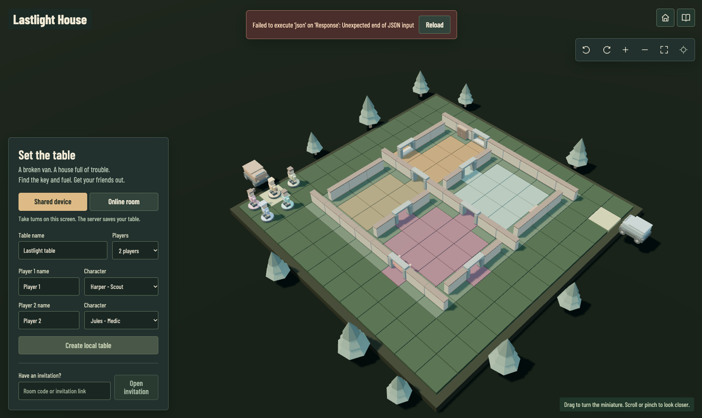
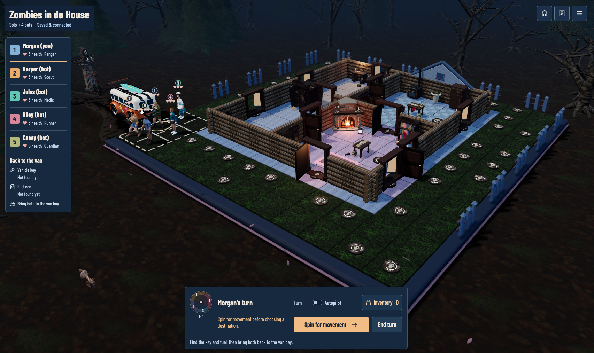
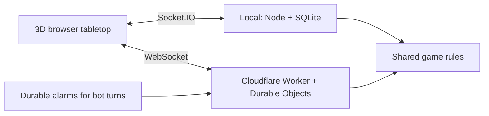

# Zombies in da House: from prototype to survival game

An original browser tabletop game: explore a monster-filled house, find the
vehicle key and fuel, and decide when to escape.

**[Play the live demo](https://zombie-in-da-house.syntal.workers.dev)** · private source repository

Play solo or with friends online or on a shared device, with optional bots and
at most five survivors in total. Eliminated survivors control monsters while
someone remains alive.

## How it evolved

A sparse 3D tabletop grew into a furnished survival game with detailed characters,
a forest setting and more ways to play. The board layout is still recognisable,
but the visual identity and the experience around it changed considerably.

| Early prototype: Lastlight House | Later gameplay: Zombies in da House |
| --- | --- |
|  |  |

_Original author-supplied captures, not reconstructed scenes. One shows setup,
the other gameplay; their dates and exact revisions are unverified. The early
prototype's error banner is retained._

The change was more than a visual reskin. Solo companions, server-controlled
autopilot, objectives and turn controls developed alongside the art and setting.
The in-game bots are separate from the AI coding agents used during development.

### Recorded development milestones

The source history progresses from the first playable implementation on
6 November to v19 on 14 November 2026: just over seven days.

| Date (2026) | Recorded change |
| --- | --- |
| 6 November | First browser tabletop with a 3D board, shared-device and online play, exploration and escape. |
| 7 November | Cloudflare runtime, solo play and bot turns scheduled durably across restarts. |
| 9-11 November | Rebuilt character and monster models, textured woodland and clearer pickup feedback. |
| 12 November | Server-controlled autopilot with the option to take back control. |
| 14 November | v19: log-cabin walls, revised van-bay escape and arrival/end-state cutscenes. |

These dates describe code milestones, not screenshot timestamps, deployment
dates or total hours worked. The source repository remains private.

## What this demonstrates

- **Server-authoritative multiplayer:** the service validates game actions and
  preserves saved outcomes across retries, reconnects, and runtime restarts.
- **Local and edge deployment:** the same game rules support Node with Socket.IO
  locally and Cloudflare Workers with Durable Objects online; durable alarms
  schedule bot turns.
- **Accessible 3D interaction:** an original browser tabletop combines animated
  models with keyboard controls and reduced-motion behavior.
- **AI-assisted product delivery:** hands-on development with coding agents,
  versioned builds, and exact-commit release checks.

The spinner shows the saved outcome rather than rerolling on refresh. The same
browser journeys run against Node and a local Worker, including reconnect,
lost-acknowledgement retry, solo play and cooperative bots.

_Personal project; opinions are my own. More: [github.com/vasilyevstan](https://github.com/vasilyevstan)_
